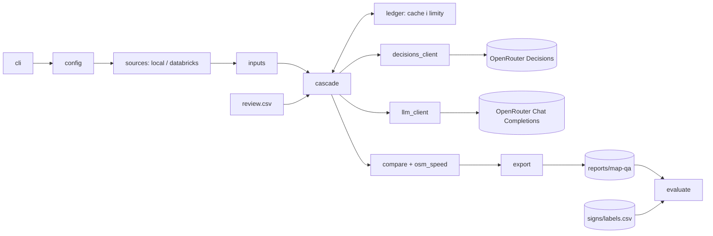
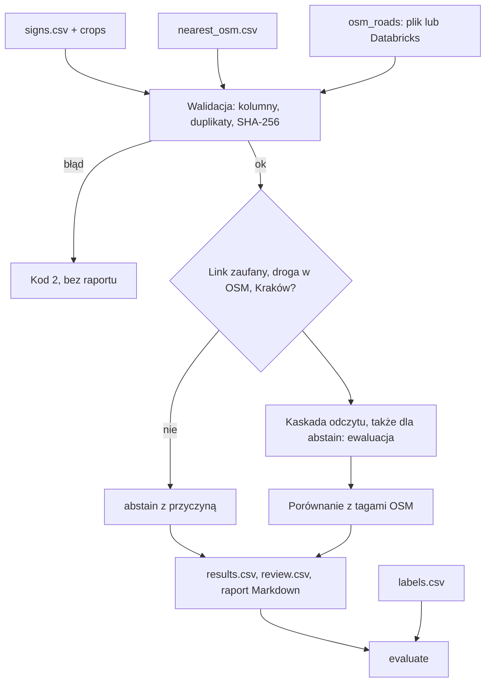
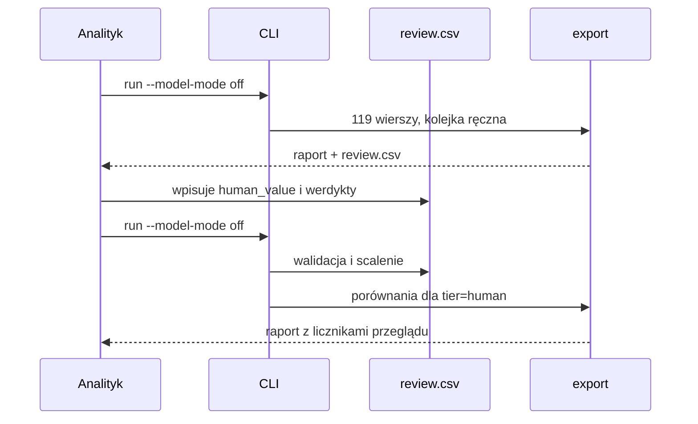

# ADR-000: Map QA — kontrola znaków prędkości, architektura główna

**Data:** 2026-11-03
**Status:** Accepted (MVP, faza 1)
**PRD:** [docs/PRD.md](../PRD.md)

---

## 1. Przegląd

Budujemy CLI dla analityka map QA. Narzędzie odczytuje wartość znaku B-33 z 119 wycinków zdjęć kaskadą: model decyzyjny → zwykły LLM → człowiek. Następnie porównuje odczyt z tagami prędkości OSM drogi wskazanej w `signs/nearest_osm.csv`. Wynik to raport Markdown, CSV wyników i CSV przeglądu z kolejką ręczną. Dane tabelaryczne mogą pochodzić z plików lokalnych albo z Databricks.

Ten dokument ustala stos, moduły, modele danych, CLI i strategię testów. Szczegóły w:
- [001-decision-cascade.md](001-decision-cascade.md): modele, kontrakt pytania, limity, cache, capture (Accepted);
- [002-data-sources-and-reports.md](002-data-sources-and-reports.md): pliki i Databricks, raporty (Accepted; HTML Proposed);
- [003-spatial-and-speed-normalization.md](003-spatial-and-speed-normalization.md): normalizacja OSM `maxspeed*` (Accepted), łączenie zdjęcia z drogą, EPSG:2180 i Overture (Proposed, faza 2).

---

## 2. Dokumentacja technologii

Identyfikatory Context7 sprawdzono 2026-11-03 przez Context7 MCP. Wersje pakietów odczytano z PyPI tego samego dnia.

| Biblioteka | Context7 ID lub dokumentacja | Użycie |
|---|---|---|
| DuckDB | `/websites/duckdb_current` | Odczyt CSV i Parquet, złączenia; spatial w fazie 2 |
| DuckDB Python | `/duckdb/duckdb-python` | API połączenia |
| OpenRouter | `/websites/openrouter_ai` | Decisions API, Chat Completions, katalog modeli |
| Databricks API | `/websites/databricks_api` | SQL Statement Execution API |
| Databricks CLI | `/databricks/cli` | Odrzucony w MVP (ADR-002) |
| GeoPandas | `/geopandas/geopandas` | Faza 2, kontrola krzyżowa (ADR-003) |
| Jinja | `/websites/jinja_palletsprojects_en_stable` | HTML w fazie 2 |
| pytest | https://docs.pytest.org/en/stable/ | Testy |
| httpx | https://www.python-httpx.org/ | Klient HTTP OpenRouter i Databricks |
| uv | https://docs.astral.sh/uv/ | Środowisko i lockfile |

---

## 3. Architektura systemu

### Wzorzec

Jednoprocesowy monolit CLI. Brak serwera, bazy danych i UI. Stan trwały to pliki: wyniki przebiegu, CSV przeglądu, cache odpowiedzi modeli i księga limitów.

### Struktura repozytorium

| Ścieżka | Zawartość |
|---|---|
| `app/pyproject.toml`, `app/uv.lock` | Projekt uv, Python 3.12, przypięte zależności |
| `app/src/map_qa/` | Kod (moduły w §4) |
| `app/tests/unit/`, `integration/`, `e2e/` | Testy według warstw (§10) |
| `app/tests/fixtures/captures/` | Realne odpowiedzi API do mocków (ADR-001 §5) |
| `app/config.example.json` | Przykładowa konfiguracja: oba typy lokalizacji, tylko nazwy zmiennych z sekretami |
| `app/samples/stage1.txt`, `stage2.txt` | Stałe listy `photo_id` próbek z PRD §12 |
| `reports/map-qa/` | Raport Markdown, `results.csv`, `review.csv`, `run.json`, log zapytań |
| `course-materials/exercise-data/map-qa/data/cache/` | Cache odpowiedzi i `ledger.json` (katalog ignorowany przez Git) |

Wejścia w `course-materials/exercise-data/map-qa/` są tylko do odczytu.

### Stos

| Warstwa | Technologia i wersja | Powód |
|---|---|---|
| Runtime | Python 3.12, uv | Wymaganie repozytorium |
| Odczyt i złączenia | DuckDB 1.5.6 | CSV i Parquet jednym silnikiem, SQL zgodny z Databricks; wersja sprawdzona skryptami ćwiczenia. DuckDB 2.0.0 (2026-10-21) to nowe wydanie główne, nieprzetestowane z tymi danymi |
| Arrow | pyarrow 23.0.1 | Wersja sprawdzona w ćwiczeniu |
| HTTP | httpx 0.28.1 | Jeden klient: OpenRouter i Databricks REST; jawny timeout, zero ponowień |
| Modele | `typesafe/jev-1.14` (tier 1), `openai/gpt-6-luna` (tier 2) | ADR-001; porównanie z `openai/gpt-6-luna-decisions` jest poza MVP |
| Raport | Markdown z biblioteki standardowej | Bez nowej zależności; HTML w fazie 2 |
| Testy | pytest 9.2.0 | Standard projektu |
| Hash | `hashlib` | Obraz wysyłany bajt w bajt; Pillow niepotrzebny |

Nie używamy klienta OpenAI, LangChain ani SDK `openrouter` (ADR-001 §6).

---

## 4. Moduły i zależności

Kierunek: `cli` → `config` → `sources` → `inputs` → `cascade` (→ `decisions_client`, `llm_client`, `ledger`) → `compare` → `export`. `evaluate` czyta wyłącznie wyniki i etykiety; nic go nie importuje. Brak cykli.

| Moduł | Odpowiedzialność | Zależy od |
|---|---|---|
| `config` | Scala ustawienia (flaga > zmienna > plik > domyślne); odrzuca plik z wartością sekretu | — |
| `sources` | Adaptery `local` i `databricks`; wspólny kontrakt tabeli i metadane źródła (ADR-002) | DuckDB, httpx |
| `inputs` | Zbiór znaków, wycinki, `nearest_osm`, tagi OSM; walidacja kolumn, duplikatów, SHA-256 | `sources` |
| `review` | Odczyt i walidacja `review.csv` (wartości ludzi, werdykty); scalanie przy kolejnym przebiegu | — |
| `ledger` | Cache odpowiedzi i trwałe liczniki prób i kosztu | system plików |
| `decisions_client` | `POST /api/alpha/decisions` | httpx |
| `llm_client` | `POST /api/v1/chat/completions` | httpx |
| `cascade` | Wartość ludzka → cache → tier 1 → tier 2 → kolejka | `ledger`, klienci, `review` |
| `osm_speed` | Normalizacja tagów `maxspeed*` (ADR-003) | — |
| `compare` | Wynik `match` / `mismatch` / `map_missing` / `not_comparable` / `abstain` / `pending_human` | `osm_speed` |
| `export` | Markdown, `results.csv`, `review.csv`, `run.json` | — |
| `evaluate` | Metryki per tier, baseline detektora; **jedyny czytelnik `signs/labels.csv`** | pliki wyników |
| `cli` | Polecenia i kody wyjścia | wszystkie |

---

## 5. Modele danych

| Model | Kluczowe pola | Trwałość |
|---|---|---|
| Sign | `photo_id`, `area`, `sequence`, `crop_path`, `crop_sha256`, autor, licencja, `source_url`, `mapillary_value` (tylko baseline) | wejście |
| RoadLink | `photo_id`, `osm_way_id`, `distance_m`, `match_flags`, `candidate_count` | wejście (`nearest_osm.csv`) |
| OsmSpeedTags | `osm_way_id`, surowe `maxspeed`, `maxspeed:forward`, `maxspeed:backward`, `maxspeed:conditional`, reguły po normalizacji, data snapshotu | wejście + ADR-003 |
| StageAnswer | `photo_id`, `tier`, `model`, `question_version`, `image_sha256`, `status`, surowa odpowiedź, `answer`, `probabilities`, `cost_usd`, `latency_ms`, `error_category`, `requested_at` | cache i `run.json` |
| SignReading | `photo_id`, `value` (liczba / `none` / `unreadable` / puste), `tier` (`decision_model` / `llm` / `human`), powody eskalacji | `results.csv` |
| Comparison | `photo_id`, `outcome`, `abstain_reason`, odczyt, `osm_way_id`, surowe tagi | `results.csv` |
| ReviewRow | `row_id`, `row_type` (`queue` / `candidate`), `photo_id`, `osm_way_id`, odpowiedź tier 1, odpowiedź tier 2, `human_value`, `outcome`, `verdict`, `comment` | `review.csv`, scalany między przebiegami |
| Ledger | liczba prób i koszt per model, limity, `experiment_id` | `ledger.json`, nie zeruje się po wznowieniu |

Żaden plik nie zawiera base64 obrazu ani wartości sekretu.

---

## 6. Interfejs CLI

| Polecenie | Wynik | Kod wyjścia |
|---|---|---|
| `map-qa run --dry-run` | Źródło i lokalizacja każdego zbioru oraz maksymalna liczba wywołań na tier; bez odczytu danych | 0 |
| `map-qa run --model-mode off` (domyślnie) | Pełny przebieg, wszystko bez wartości ludzkiej → `pending_human` | 0 |
| `map-qa run --model-mode cache` | Tylko cache; braki → `model_unavailable` → kolejka | 0 |
| `map-qa run --model-mode live --sample stage1 [--yes]` | Wywołania w limitach; potwierdzenie przed pierwszym | 0, także gdy limit lub budżet tieru się wyczerpał: tier jest pomijany, znaki idą dalej kaskadą, a raport podaje, który limit osiągnięto (PRD §4.7) |
| `map-qa evaluate` | Sekcja ewaluacji z etykiet | 0 |
| błędy wejścia, źródła, `review.csv` | Jedna linia z nazwą zbioru, pliku, kolumny, zmiennej lub wiersza | 2 |

Opcje: `--source`, `--source-<dataset>`, `--config`, `--out`, `--threshold`, `--max-requests-tier1/2`, `--max-cost-tier1/2`, `--review`. Nazwy utrwala test kontraktu CLI przed implementacją.

Zgodnie z PRD §4.7 błąd modelu nie przerywa przebiegu: tier jest pomijany jako `model_unavailable`, a znak idzie dalej kaskadą.

---

## 7. Zmienne środowiskowe

| Zmienna | Cel | Wymagana | Przykład |
|---|---|---|---|
| `OPENROUTER_API_KEY` | Uwierzytelnienie OpenRouter; kod sprawdza tylko obecność | tylko `live` | (nie podawać) |
| `MAPQA_CONFIG` | Ścieżka konfiguracji | nie | `app/config.example.json` |
| `MAPQA_SOURCE`, `MAPQA_SOURCE_OSM_ROADS` | Źródło wszystkich zbiorów / jednego zbioru | nie | `databricks` |
| `MAPQA_MODEL_MODE` | Domyślny tryb modeli | nie | `off` |
| `DATABRICKS_HOST` | Host workspace (HTTPS, bez `/` na końcu) | gdy jakiś zbiór z Databricks | `https://…` |
| `DATABRICKS_TOKEN` | Token z zakresem `sql` | j.w. | (nie podawać) |
| `DATABRICKS_SQL_WAREHOUSE_ID` | Warehouse | j.w. | `97c455ee6fb1fcb9` |

---

## 8. Decyzje techniczne

### Silnik odczytu: DuckDB
**Status:** Accepted
**Kontekst:** MVP czyta CSV i Parquet bez geometrii; faza 2 potrzebuje spatial i SQL przenośnego do Databricks.
**Decyzja:** DuckDB 1.5.6 do odczytu i złączeń po identyfikatorach.
**Odrzucone:**
- pandas: drugi model danych obok SQL.
- GeoPandas: geometria w MVP niepotrzebna (ADR-003).
**Konsekwencje:** (+) jeden silnik teraz i w fazie 2; (−) wymaga jawnych typów kolumn.
**Wyzwalacz przeglądu:** przejście na DuckDB 2.x.

### Jawne typy przy odczycie CSV
**Status:** Accepted
**Kontekst:** `heading=0.0` to północ; pusty heading to brak; identyfikatory wyglądają jak liczby (zasada z README danych ćwiczenia).
**Decyzja:** Każdy CSV z jawnymi typami; identyfikatory jako tekst; puste pola liczbowe jako NULL, nigdy 0.
**Odrzucone:** autodetekcja typów, bo zmienia znaczenie danych bez ostrzeżenia.
**Konsekwencje:** (+) brak cichych konwersji; (−) zmiana schematu wymaga zmiany definicji.
**Wyzwalacz przeglądu:** nowa wersja wejść.

### Wyniki w plikach
**Status:** Accepted
**Kontekst:** Jeden analityk, 119 znaków, ręczna edycja `review.csv`.
**Decyzja:** CSV i Markdown w `reports/map-qa/`, JSON dla manifestu przebiegu i księgi.
**Odrzucone:** baza DuckDB, bo nie da się jej przeglądać diffem ani edytować w arkuszu.
**Konsekwencje:** (+) czytelne bez narzędzi; (−) scalanie `review.csv` musi być deterministyczne.
**Wyzwalacz przeglądu:** wielu analityków równocześnie.

### Próbki jako stałe listy identyfikatorów
**Status:** Accepted
**Kontekst:** PRD §12 definiuje próbki etapów 1 i 2 według etykiet; etykiety nie mogą trafić do przebiegu.
**Decyzja:** Listy `photo_id` są wybierane raz, jednorazowym skryptem w `reports/map-qa/`, i zapisywane w `app/samples/`. Aplikacja czyta tylko listę identyfikatorów. Wybór jest zatwierdzony przed pierwszym płatnym wywołaniem.
**Odrzucone:** losowanie w aplikacji, bo wymagałoby odczytu etykiet w ścieżce przebiegu.
**Konsekwencje:** (+) próbka jest powtarzalna i przeglądana w diffie; (−) zmiana próbki wymaga commita.
**Wyzwalacz przeglądu:** nowy zestaw znaków.

---

## 9. Diagramy

### 9.1 Komponenty

### 9.2 Przepływ danych

### 9.3 Sekwencja: przebieg z kolejną rundą przeglądu

---

## 10. Strategia testów

### Zasady

1. Testy przed kodem: test → oczekiwany Red z właściwego powodu → minimum kodu → Green → refaktoryzacja przy zielonych testach.
2. Mock API wyłącznie z zapisanego, realnego capture (ADR-001 §5). Bez capture testujemy logikę na sparsowanych obiektach i nie wymyślamy kształtu odpowiedzi.
3. Każdy etap kończy się rzeczywistym uruchomieniem CLI na plikach ćwiczenia i ręcznym prześledzeniem jednego znaku od wycinka do wiersza raportu.
4. Raport etapu podaje osobno: `uv sync`, discovery i liczbę testów z pominięciami, start CLI, ręczną kontrolę.

### Warstwy

| Warstwa | Mocki | Zakres | Narzędzie |
|---|---|---|---|
| Unit | wszystkie zależności | reguły, parsowanie, konfiguracja, scalanie review | pytest |
| Integration | tylko zewnętrzny LLM i Databricks, z capture | prawdziwe pliki ćwiczenia, prawdziwy DuckDB | pytest + `httpx.MockTransport` |
| E2E | brak | prawdziwy CLI, pliki, OpenRouter i Databricks | pytest z markerem `live`, domyślnie pominięty z podaną przyczyną |

### Kluczowe scenariusze (etap 0)

| Scenariusz | Wejście | Oczekiwany wynik |
|---|---|---|
| Pełny przebieg off | 119 znaków | 119 wierszy, każdy z jednym wynikiem (AC-05); zero żądań HTTP |
| Abstencja | flaga w `match_flags`; droga spoza OSM; obszar poza Krakowem | `abstain` z przyczyną; znak nadal w ewaluacji (AC-06, AC-07) |
| Brak wejścia | brak pliku lub kolumny | kod 2, nazwa zbioru i elementu, brak raportu (AC-02) |
| Runda przeglądu | `review.csv` z wartością i werdyktem | wartości zachowane, porównanie z `tier=human`, zero wywołań (AC-29, AC-30) |
| Błędny review | werdykt spoza zbioru | kod 2, wiersz i wartość, plik bez zmian (AC-31) |
| Wejścia niezmienione | dowolny przebieg | hashe przed = po (AC-01) |

### Techniczne kryteria akceptacji

- TAC-000-01: `uv sync` i `uv run pytest` w `app/` kończą się bez błędów; raport podaje liczbę testów i pominięć z przyczyną.
- TAC-000-02: Przebieg `off` na 119 znakach nie wykonuje żadnego żądania (transport testowy zgłasza błąd przy każdym żądaniu).
- TAC-000-03: Dwa przebiegi z identycznymi wejściami dają identyczny raport poza linią czasu (AC-03).
- TAC-000-04: Żaden plik wyników ani cache nie zawiera `data:image` ani wartości sekretów (test skanujący).
- TAC-000-05: Test architektury: tylko moduł `evaluate` odwołuje się do `labels.csv`.
