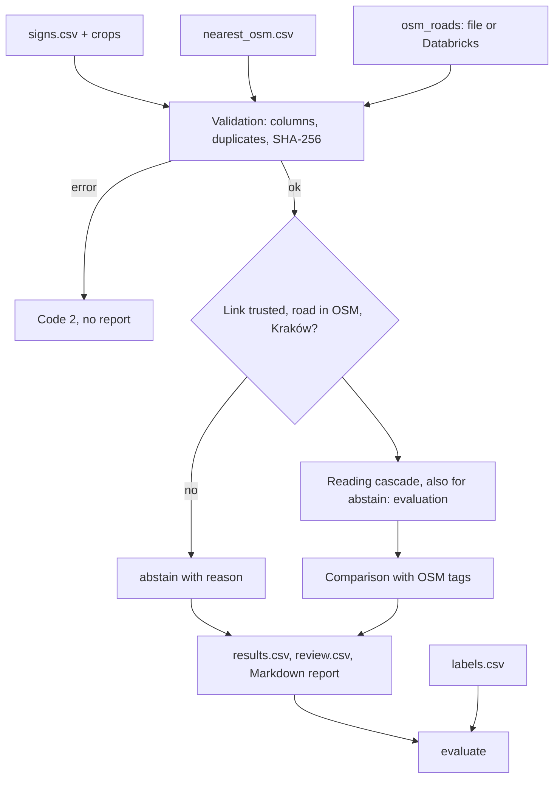
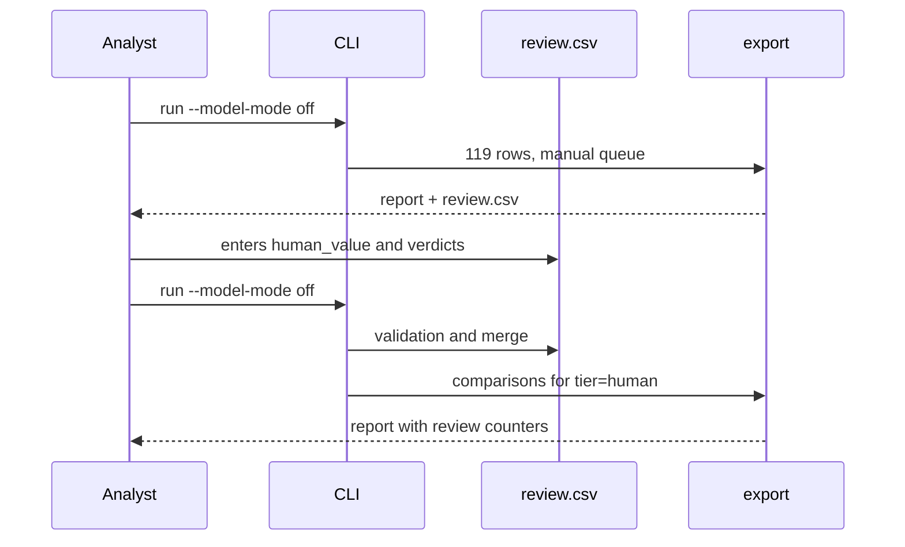

# ADR-000: Map QA — speed sign check, main architecture

**Date:** 2026-11-03 (updated 2026-11-12: data profile, live Databricks read)
**Status:** Accepted (MVP, phase 1)
**PRD:** [docs/PRD.md](../PRD.md)
**Data profile:** [reports/map-qa/profile.md](../../reports/map-qa/profile.md)

---

## 1. Overview

We are building a CLI for a map QA analyst. The tool reads the value of the B-33 sign from 119 photo crops through a cascade: decision model → plain LLM → human. It then compares the reading with the OSM speed tags of the road given in `signs/nearest_osm.csv`. The output is a Markdown report, a results CSV and a review CSV with the manual queue. Tabular data can come from local files or from Databricks.

This document sets the stack, modules, data models, CLI and test strategy. Details in:
- [001-decision-cascade.md](001-decision-cascade.md): models, question contract, limits, cache, capture (Accepted);
- [002-data-sources-and-reports.md](002-data-sources-and-reports.md): files and Databricks, reports (Accepted; HTML Proposed);
- [003-spatial-and-speed-normalization.md](003-spatial-and-speed-normalization.md): normalization of OSM `maxspeed*` (Accepted), linking a photo to a road, EPSG:2180 and Overture (Proposed, phase 2).

The input profile from 2026-11-12 confirms the assumptions of these ADRs:
- No invalid geometry, no duplicate keys, and every `photo_id` and road reference resolves.
- The five `workspace.map_qa` tables in Databricks have the same row counts as the local files.

Details and the facts that changed decisions are in [reports/map-qa/profile.md](../../reports/map-qa/profile.md).

---

## 2. Technology documentation

Context7 IDs were checked on 2026-11-03 via Context7 MCP. Package versions were read from PyPI on the same day.

| Library | Context7 ID or documentation | Use |
|---|---|---|
| DuckDB | `/websites/duckdb_current` | Reading CSV and Parquet, joins; spatial in phase 2 |
| DuckDB Python | `/duckdb/duckdb-python` | Connection API |
| OpenRouter | `/websites/openrouter_ai` | Decisions API, Chat Completions, model catalog |
| Databricks API | `/websites/databricks_api` | SQL Statement Execution API |
| Databricks CLI | `/databricks/cli` | Not used by the app in the MVP (Proposed, ADR-002); v1.26.0 installed on the VM for manual checks |
| GeoPandas | `/geopandas/geopandas` | Phase 2, cross-check (ADR-003) |
| Jinja | `/websites/jinja_palletsprojects_en_stable` | HTML in phase 2 |
| pytest | https://docs.pytest.org/en/stable/ | Tests |
| httpx | https://www.python-httpx.org/ | HTTP client for OpenRouter and Databricks |
| uv | https://docs.astral.sh/uv/ | Environment and lockfile |

---

## 3. System architecture

### Pattern

Single-process CLI monolith. No server, database or UI. Persistent state is files: run results, the review CSV, the model response cache and the limits ledger.

### Repository structure

| Path | Contents |
|---|---|
| `app/pyproject.toml`, `app/uv.lock` | uv project, Python 3.12, pinned dependencies |
| `app/src/map_qa/` | Code (modules in §4) |
| `app/tests/unit/`, `integration/`, `e2e/` | Tests by layer (§10) |
| `app/tests/fixtures/captures/` | Real API responses for mocks (ADR-001 §5) |
| `app/config.example.json` | Example configuration: both location types, only names of variables holding secrets |
| `app/samples/stage1.txt`, `stage2.txt` | Fixed `photo_id` lists of the samples from PRD §12 |
| `reports/map-qa/` | Markdown report, `results.csv`, `review.csv`, `run.json`, query log |
| `app/.cache/map-qa/` | Response cache and `ledger.json` (directory ignored by Git) |

Inputs in `course-materials/exercise-data/map-qa/` are read-only. The tool writes nothing there, including the cache; this way AC-01 covers the whole input folder.

### Stack

| Layer | Technology and version | Reason |
|---|---|---|
| Runtime | Python 3.12, uv | Repository requirement |
| Reading and joins | DuckDB 1.5.6 | CSV and Parquet with one engine, SQL compatible with Databricks; version verified by the exercise scripts. DuckDB 2.0.0 (2026-10-21) is a new major release, untested with this data |
| Arrow | pyarrow 23.0.1 | Version verified in the exercise |
| HTTP | httpx 0.28.1 | One client: OpenRouter and Databricks REST; explicit timeout, zero retries |
| Models | `typesafe/jev-1.14` (tier 1), `openai/gpt-6-luna` (tier 2) | ADR-001; comparison with `openai/gpt-6-luna-decisions` is outside the MVP |
| Report | Markdown from the standard library | No new dependency; HTML in phase 2 |
| Tests | pytest 9.2.0 | Project standard |
| Hash | `hashlib` | Image sent byte for byte; Pillow not needed |

We do not use the OpenAI client, LangChain or the `openrouter` SDK (ADR-001 §6).

---

## 4. Modules and dependencies

Direction: `cli` → `config` → `sources` → `inputs` → `cascade` (→ `decisions_client`, `llm_client`, `ledger`) → `compare` → `export`. `evaluate` reads only results and labels; nothing imports it. No cycles.

| Module | Responsibility | Depends on |
|---|---|---|
| `config` | Merges settings (flag > variable > file > defaults); rejects a file containing a secret value | — |
| `sources` | `local` and `databricks` adapters; shared table contract and source metadata (ADR-002) | DuckDB, httpx |
| `inputs` | Sign set, crops, `nearest_osm`, OSM tags; validation of columns, duplicates, SHA-256 | `sources` |
| `review` | Reading and validating `review.csv` (human values, verdicts); merging on the next run | — |
| `ledger` | Response cache and persistent attempt and cost counters | file system |
| `decisions_client` | `POST /api/alpha/decisions` | httpx |
| `llm_client` | `POST /api/v1/chat/completions` | httpx |
| `cascade` | Human value → cache → tier 1 → tier 2 → queue | `ledger`, clients, `review` |
| `osm_speed` | Normalization of `maxspeed*` tags (ADR-003) | — |
| `compare` | Outcome `match` / `mismatch` / `map_missing` / `not_comparable` / `abstain` / `pending_human` | `osm_speed` |
| `export` | Markdown, `results.csv`, `review.csv`, `run.json` | — |
| `evaluate` | Per-tier metrics, detector baseline; **the only reader of `signs/labels.csv`** | result files |
| `cli` | Commands and exit codes | all |

---

## 5. Data models

| Model | Key fields | Persistence |
|---|---|---|
| Sign | `photo_id`, `area`, `sequence`, `crop_path`, `crop_sha256`, author, license, `source_url`, `mapillary_value` (baseline only) | input |
| RoadLink | `photo_id`, `osm_way_id`, `distance_m`, `match_flags`, `candidate_count` | input (`nearest_osm.csv`) |
| OsmSpeedTags | `osm_way_id`, raw `maxspeed`, `maxspeed:forward`, `maxspeed:backward`, `maxspeed:conditional`, raw implicit-limit tag (`maxspeed:type` / `source:maxspeed` / `zone:maxspeed` from `osm_roads.tags`), rules after normalization, snapshot date | input + ADR-003 |
| StageAnswer | `photo_id`, `tier`, `model`, `question_version`, `image_sha256`, `status`, raw response, `answer`, `probabilities`, `cost_usd`, `latency_ms`, `error_category`, `requested_at` | cache and `run.json` |
| SignReading | `photo_id`, `value` (number / `none` / `unreadable` / empty), `tier` (`decision_model` / `llm` / `human`), escalation reasons | `results.csv` |
| Comparison | `photo_id`, `outcome`, `abstain_reason`, reading, `osm_way_id`, raw tags | `results.csv` |
| ReviewRow | `row_id`, `row_type` (`queue` / `candidate`), `photo_id`, `osm_way_id`, tier 1 answer, tier 2 answer, `human_value`, `outcome`, `verdict`, `comment` | `review.csv`, merged between runs |
| Ledger | number of attempts and cost per model, limits, `experiment_id` | `ledger.json`, not reset on resume |

No file contains a base64 image or a secret value.

---

## 6. CLI interface

| Command | Result | Exit code |
|---|---|---|
| `map-qa run --dry-run` | Source and location of each dataset and the maximum number of calls per tier; no data is read | 0 |
| `map-qa run --model-mode off` (default) | Full run, everything without a human value → `pending_human` | 0 |
| `map-qa run --model-mode cache` | Cache only; misses → `model_unavailable` → queue | 0 |
| `map-qa run --model-mode live --sample stage1 [--yes]` | Calls within limits; confirmation before the first one | 0, also when a tier's limit or budget is exhausted: the tier is skipped, signs continue down the cascade, and the report states which limit was reached (PRD §4.7) |
| `map-qa evaluate` | Evaluation section from labels | 0 |
| input, source, `review.csv` errors | One line naming the dataset, file, column, variable or row | 2 |

Options: `--source`, `--source-<dataset>`, `--config`, `--out`, `--threshold`, `--max-requests-tier1/2`, `--max-cost-tier1/2`, `--review`. The names are fixed by a CLI contract test before implementation.

Per PRD §4.7, a model error does not stop the run: the tier is skipped as `model_unavailable`, and the sign continues down the cascade.

---

## 7. Environment variables

| Variable | Purpose | Required | Example |
|---|---|---|---|
| `OPENROUTER_API_KEY` | OpenRouter authentication; code checks only that it is present | `live` only | (do not provide) |
| `MAPQA_CONFIG` | Configuration path | no | `app/config.example.json` |
| `MAPQA_SOURCE`, `MAPQA_SOURCE_OSM_ROADS` | Source of all datasets / of one dataset | no | `databricks` |
| `MAPQA_MODEL_MODE` | Default model mode | no | `off` |
| `DATABRICKS_HOST` | Workspace host (HTTPS, no trailing `/`) | when any dataset comes from Databricks | `https://…` |
| `DATABRICKS_TOKEN` | Token with `sql` scope | as above | (do not provide) |
| `DATABRICKS_SQL_WAREHOUSE_ID` | Warehouse | as above | `97c455ee6fb1fcb9` |

---

## 8. Technical decisions

### Reading engine: DuckDB
**Status:** Accepted
**Context:** The MVP reads CSV and Parquet without geometry; phase 2 needs spatial and SQL portable to Databricks.
**Decision:** DuckDB 1.5.6 for reading and joins on identifiers.
**Rejected:**
- pandas: a second data model alongside SQL.
- GeoPandas: geometry is not needed in the MVP (ADR-003).
**Consequences:** (+) one engine now and in phase 2; (−) requires explicit column types.
**Review trigger:** moving to DuckDB 2.x.

### Explicit types when reading CSV
**Status:** Accepted
**Context:** `heading=0.0` is north; an empty heading is missing; identifiers look like numbers (rule from the exercise data README).
**Decision:** Every CSV is read with explicit types; identifiers as text; empty numeric fields as NULL, never 0.
**Rejected:** type autodetection, because it changes the meaning of data without warning.
**Consequences:** (+) no silent conversions; (−) a schema change requires a definition change.
**Review trigger:** a new version of the inputs.

### Results in files
**Status:** Accepted
**Context:** One analyst, 119 signs, manual editing of `review.csv`.
**Decision:** CSV and Markdown in `reports/map-qa/`, JSON for the run manifest and the ledger.
**Rejected:** a DuckDB database, because it cannot be reviewed with a diff or edited in a spreadsheet.
**Consequences:** (+) readable without tools; (−) merging `review.csv` must be deterministic.
**Review trigger:** several analysts working at the same time.

### Samples as fixed identifier lists
**Status:** Accepted
**Context:** PRD §12 defines the stage 1 and stage 2 samples based on labels; labels must not enter the run.
**Decision:** The `photo_id` lists are selected once, by a one-off script in `reports/map-qa/`, and saved in `app/samples/`. The application reads only the identifier list. The selection is approved before the first paid call.
**Rejected:** random sampling in the application, because it would require reading labels in the run path.
**Consequences:** (+) the sample is reproducible and reviewed in a diff; (−) changing the sample requires a commit.
**Review trigger:** a new set of signs.

---

## 9. Diagrams

### 9.1 Components

### 9.2 Data flow

### 9.3 Sequence: run with a subsequent review round

---

## 10. Test strategy

### Principles

1. Tests before code: test → expected Red for the right reason → minimum code → Green → refactoring while tests stay green.
2. API mocks only from a saved, real capture (ADR-001 §5). Without a capture we test logic on parsed objects and do not invent the response shape.
3. Each stage ends with a real CLI run on the exercise files and a manual trace of one sign from crop to report row.
4. The stage report lists separately: `uv sync`, discovery and test count with skips, CLI startup, manual check.

### Layers

| Layer | Mocks | Scope | Tool |
|---|---|---|---|
| Unit | all dependencies | rules, parsing, configuration, review merging | pytest |
| Integration | only the external LLM and Databricks, from capture | real exercise files, real DuckDB | pytest + `httpx.MockTransport` |
| E2E | none | real CLI, files, OpenRouter and Databricks | pytest with the `live` marker, skipped by default with a stated reason |

### Key scenarios (stage 0)

| Scenario | Input | Expected result |
|---|---|---|
| Full off run | 119 signs | 119 rows, each with one outcome (AC-05); zero HTTP requests |
| Abstention | flag in `match_flags`; road outside OSM; area outside Kraków | `abstain` with reason; sign still in evaluation (AC-06, AC-07) |
| Missing input | missing file or column | code 2, name of dataset and element, no report (AC-02) |
| Review round | `review.csv` with value and verdict | values preserved, comparison with `tier=human`, zero calls (AC-29, AC-30) |
| Invalid review | verdict outside the allowed set | code 2, row and value, file unchanged (AC-31) |
| Inputs unchanged | any run | hashes before = after (AC-01) |

### Technical acceptance criteria

- TAC-000-01: `uv sync` and `uv run pytest` in `app/` finish without errors; the report gives the number of tests and skips with reasons.
- TAC-000-02: An `off` run on 119 signs makes no request (the test transport raises an error on every request).
- TAC-000-03: Two runs with identical inputs produce an identical report apart from the time line (AC-03).
- TAC-000-04: No result or cache file contains `data:image` or secret values (scanning test).
- TAC-000-05: Architecture test: only the `evaluate` module refers to `labels.csv`.
