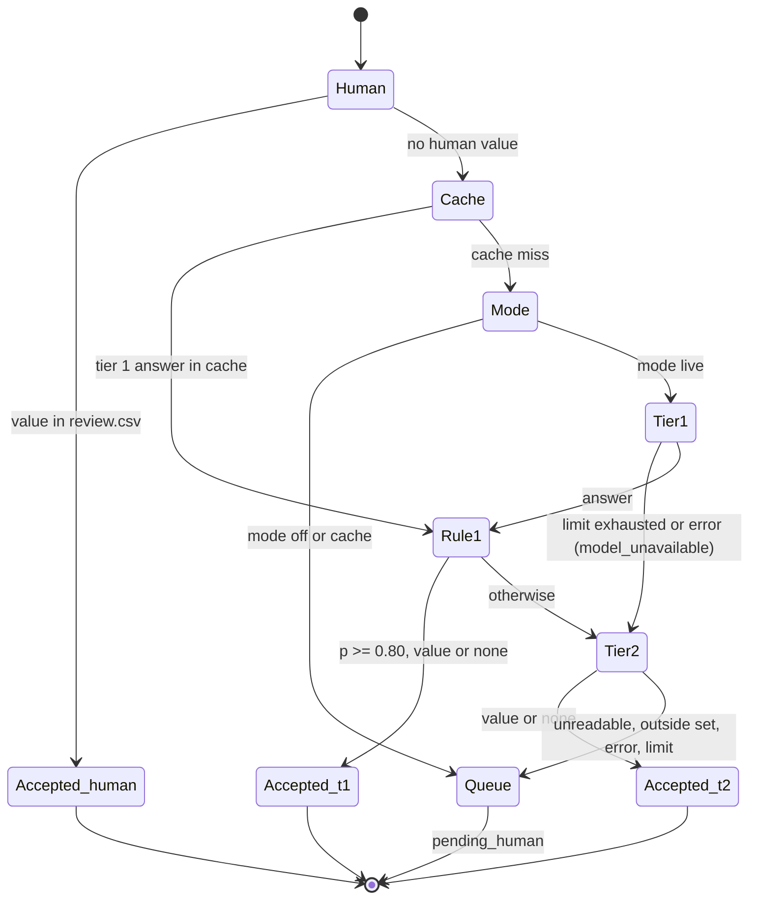
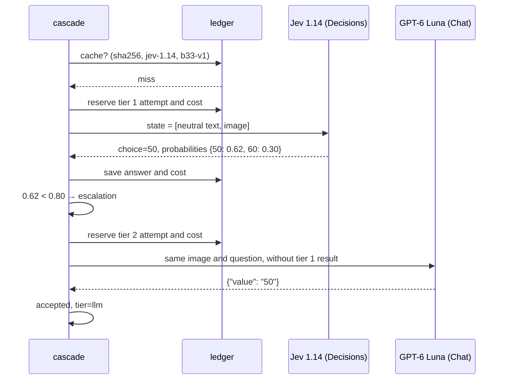
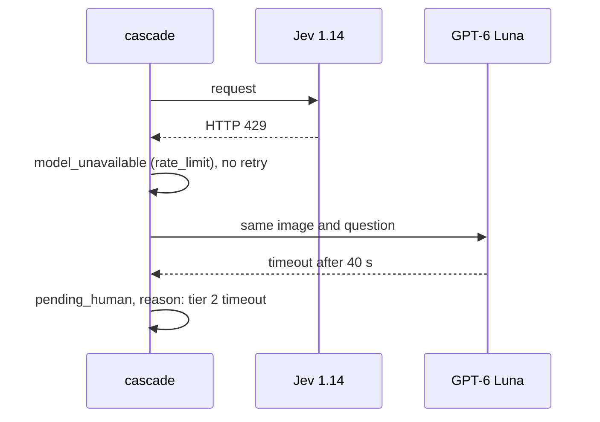

# ADR-001: Sign reading cascade: decision model → plain LLM → human

**Date:** 2026-11-03
**Status:** Accepted
**Relates to:** [000-main-architecture.md](000-main-architecture.md); PRD §4.4–4.5, §11, §12, AC-08…AC-18, AC-32…AC-36

---

## 1. Scope

Choice of models and client, question contract, acceptance and escalation rules, limits, timeout, cache, capture for mocks, evaluation. Does not cover the map comparison (ADR-000, ADR-003) or data sources (ADR-002).

---

## 2. Documentation (checked 2026-11-03)

| Source | Context7 ID or link | What was confirmed |
|---|---|---|
| Decisions API | `/websites/openrouter_ai`; https://openrouter.ai/docs/guides/community/multimodal-decisions | `POST https://openrouter.ai/api/alpha/decisions` with fields `model`, `state`, `questions`. An image is an element of the `state` array in the form `{"type":"image_url","image_url":{"url":"data:image/…;base64,…"}}`, and text in `state` is a plain string |
| Question types | https://openrouter.ai/docs/guides/community/jev | A `choice` question has `criteria` (label → description). Response: `answers.<name>.choice`, `probabilities`, `confidence`; the schema marks the last two fields as optional. The response contains `usage.cost` |
| Python SDK | https://openrouter.ai/docs/client-sdks/python/sdks/decisions/README | `open_router.alpha.decisions.create` exists and has a `retries` parameter that overrides the **client's default retries** (`backoff` strategy) |
| Chat Completions | https://openrouter.ai/docs/api/api-reference/chat/create-a-chat-completion | `reasoning.effort` accepts `medium`; `response_format` of type `json_schema` with `strict` |
| Model catalog | `GET https://openrouter.ai/api/v1/models` (read 2026-11-03) | Prices and modalities in §3. Decision model latencies are not published (`latency_last_30m = null`) |

---

## 3. Models

| Role | Model | Input | Price per 1M tokens (2026-11-03) |
|---|---|---|---|
| Tier 1 | `typesafe/jev-1.14` | text, image; context 262 144 | input 0.042 USD, output 0 |
| Comparison (Proposed, outside MVP) | `openai/gpt-6-luna-decisions` | text, image; context 1 050 000 | input 0.10 USD, output 0 |
| Tier 2 | `openai/gpt-6-luna` | text, image; reasoning, structured outputs | input 0.10 USD, output 0.50 USD |

The identifiers are in the configuration. Changing a model changes the cache key.

---

## 4. Question contract

### Version

`question_version = b33-v1`. Every change to the question text, labels or schema bumps the version. The version, threshold and limits are written to `run.json` before the first paid call on labeled signs, i.e. before stage 1, and do not change until the end of stage 2 (AC-14). Changing the threshold after stage 1 requires a new rule version and a new evaluation on held-out signs (PRD §12), not on the ones already measured.

### Answer set (PRD §11)

- values: `5, 10, 15, 20, 25, 30, 35, 40, 45, 50, 55, 60, 65, 70, 75, 80, 90, 100, 110, 120, 130, 140`;
- `none`: the crop contains no circular B-33 (zone, end of zone, end of limit, another sign, no sign);
- `unreadable`: a B-33 is visible, but its value cannot be read.

### Tier 1: Decisions, `choice` question

- `questions`: one question `b33_value` of type `choice`, with neutral `instructions` in English and `criteria` containing every label and a short description.
- `state`: an array with exactly two elements: the fixed text "Street-level photo crop." and the crop image as a data URL with the file bytes and the MIME type based on the extension.
- **Nothing else goes into `state`:** no file name, `photo_id`, map value, `mapillary_value`, label, area or date (AC-13). A contract test compares the built request body against the list of allowed fields.

### Tier 2: Chat Completions

- The same image bytes and the same question text. Without the tier 1 answer and distribution (AC-12).
- `reasoning.effort = medium`. The reasoning trace does not go into the results.
- `response_format = json_schema`, `strict`, with a single field `value` whose value is from the answer set (enum).

### Acceptance rules (`accept-v1`)

| Tier | Accepts | Escalates |
|---|---|---|
| 1 | `probabilities` is present, the highest ≥ 0.80, and the label is a value or `none` | highest < 0.80; label `unreadable`; missing `probabilities`; `model_unavailable` |
| 2 | JSON valid against the schema, `value` is a value or `none` | `unreadable`; schema mismatch; answer outside the set; `model_unavailable` |

Missing `probabilities` is not replaced by the `confidence` field. The 0.80 threshold is the starting value from the PRD. Threshold exploration (AC-36) is done in `cache` mode on the stored distributions and marked as exploratory.

---

## 5. Client, limits, cache, capture

### Client: raw POST via httpx

- One `httpx.Client` for both endpoints: 40 s timeout, no retries, no redirects.
- `Authorization: Bearer` built from `OPENROUTER_API_KEY` at call time. The code only checks that the key is present, and its value does not go into logs, exceptions, captures or results.
- Error categories: 400/413 → `bad_request`; 401/403 → `auth`; 402 → `payment`; 404 → `not_found`; 408/524/timeout → `timeout`; 429 → `rate_limit`; 5xx/529 → `provider`. Every error yields `model_unavailable` for the given tier, and the sign moves on through the cascade (PRD §4.7). There are no retries.

### Limits (PRD §8)

| Model | Attempt limit | Cost limit |
|---|---|---|
| Tier 1 (Jev) | 25 | from the trainer's allocation |
| Tier 2 (Luna) | 10 | from the trainer's allocation |

The MVP calls no other paid models. `--dry-run` (AC-44) shows at most 25 + 10 calls.

- The counter is incremented **before** the request is sent and includes errors, timeouts and captures (AC-15).
- Before each request the system reserves a fixed, configurable amount per call. Default values:

  | Tier | Reservation | Basis (prices from 2026-11-03) |
  |---|---|---|
  | 1 (Jev) | 0.0005 USD | approx. 12 000 input tokens × 0.042 USD/1M, with headroom; output free |
  | 2 (Luna) | 0.004 USD | 12 000 input tokens × 0.10 USD/1M + `max_tokens = 4000` (including reasoning tokens) × 0.50 USD/1M, with headroom |

  If the cost used so far plus the reservation would exceed the tier's cost limit, the request is not sent and the tier is disabled until the end of the run.
- After the response, the reservation is replaced by `usage.cost`. If that field is missing, the reservation stays. If `usage.cost` exceeds the reservation, the tier is disabled until the end of the run, and the report shows both amounts; the reservation must be raised in the configuration before the next run.
- `ledger.json` is persistent per `experiment_id`; resuming does not reset the counters.

### Cache

- Key: SHA-256 of the image + model identifier + `question_version`. The threshold is not part of the key (AC-16).
- Value: the full raw response, `usage`, time, HTTP status. Errors are not cached.

### Capture for mocks

- The first real request to each model, counted against the limit, saves a capture in `app/tests/fixtures/captures/`. The capture contains: date, endpoint, model, application version, status, response headers without authentication headers and account identifiers, and the full unchanged response body. In the request body the image is replaced with a `<image sha256=…>` marker.
- Integration mocks read only these files. Without a capture, the parser tests for that endpoint are skipped with the reason "no capture".

---

## 6. Technical decisions

### Raw POST via httpx instead of the `openrouter` SDK
**Status:** Accepted
**Context:** The Decisions endpoint is in alpha. The `openrouter` SDK 1.3.107 was released on 2026-11-02, and its methods retry requests by default. The PRD requires no retries, a fixed timeout and safe capture.
**Decision:** httpx with explicit configuration; one client for both endpoints.
**Rejected:**
- SDK with `retries` disabled: possible, but the default retries are easy to bring back when a call is changed, and alpha types change between releases.
- OpenAI client: excluded; it does not support `/api/alpha/decisions`.
**Consequences:** (+) no hidden retries, 1:1 capture; (−) custom parsing and error mapping.
**Review trigger:** the Decisions API leaves alpha.

### Jev 1.14 as tier 1; comparison with Luna Decisions outside the MVP
**Status:** Accepted (Jev); Proposed (comparison)
**Context:** Both models accept images and return a distribution; Jev is about 2.4 times cheaper per input token. The PRD §8 limits cover only tier 1 and tier 2.
**Decision:** Jev in the cascade. A comparison with Luna Decisions on the same 5 stage 1 crops is possible only after a separate limit (5 calls) and a budget allocation are added to the PRD. Until then the code does not call this model.
**Rejected:**
- Luna Decisions as tier 1: more expensive with no measured advantage.
- Comparison within the tier 1 limit: it would use 5 of the 25 calls that PRD §12 already splits between stages 1 and 2.
**Consequences:** (+) cost consistent with the PRD; (−) the choice of Jev is not based on a quality measurement.
**Review trigger:** the PRD gets a comparison limit, or Jev does not meet the goals from PRD §12.

### GPT-6 Luna as tier 2
**Status:** Accepted
**Context:** Tier 2 is meant to be a plain LLM with medium reasoning and image support; the choice was made by the user.
**Decision:** `openai/gpt-6-luna`, `reasoning.effort = medium`, strict `json_schema`.
**Rejected:**
- `anthropic/claude-haiku-5.5`: same price, rejected by the user's decision.
- `anthropic/claude-sonnet-5.5`: 20 times more expensive.
**Consequences:** (+) low cost, a different provider than Jev; (−) the same family as Luna Decisions, so any future comparison of these two models will not be independent. The LLM does not return a calibrated distribution, so the PRD accepts any answer from the set.
**Review trigger:** a wrong tier 2 acceptance in stage 2, or tier 1 being changed to a model from the Luna family.

### Confidence from the distribution, not from a declaration
**Status:** Accepted
**Context:** A textual declaration of confidence cannot be verified.
**Decision:** Tier 1 accepts an answer based on `probabilities`. Tier 2 does not report confidence.
**Rejected:** a "confidence" field in the tier 2 schema.
**Consequences:** (+) a predictable criterion; (−) tier 2 may accept a wrong reading, which the evaluation measures.
**Review trigger:** the phase 2 PRD introduces escalation on tier disagreement.

---

## 7. Evaluation (PRD §12, AC-32…AC-36)

- `evaluate` reads `signs/labels.csv` only after the run.
- The `uncertain` and `unreadable` labels are excluded from denominators and counted separately.
- Detector baseline: class `regulatory--maximum-speed-limit-N--…` → N; any other class or no class → `none`.
- Metrics per tier and for the whole cascade: sent, accepted, escalated, errors, accuracy of accepted answers, wrong acceptances, `none` or escalation for negatives, requests, cost and cost per accepted answer. Every metric has an explicit denominator.
- The goals from PRD §12 are written into the evaluation configuration before stage 1, and the report shows "met / not met" without tuning the thresholds.

---

## 8. Diagrams

### States

### Sequence: escalation

### Sequence: service error

---

## 9. Test strategy

| Scenario | Type | Input | Expected result | Edge cases |
|---|---|---|---|---|
| Request building | unit | Sign | `state` = [text, image]; no `photo_id`, path, `mapillary_value` | .jpg/.png |
| Tier 1 rule | unit | distributions | acceptance only at ≥ 0.80 and label ≠ `unreadable` | exactly 0.80; `none` 0.95; missing `probabilities` |
| Escalation to tier 2 | unit | low distribution + `{"value":"none"}` | `accepted`, `tier=llm` | answer outside the set → queue |
| Limits and budget | unit + integration | limit 1, two signs | second: tier skipped, `model_unavailable`, counter in the report | reservation above the cost limit |
| Cache and resume | integration | live run (mock from capture), then cache | second run: 0 requests, same results (AC-03) | threshold change: recomputation without requests |
| Service error | integration | 429, timeout | `model_unavailable`, sign moves on, transport counts 1 request | error in both tiers → queue |

E2E `live` only after the budget is granted: first one capture request per model, then stage 1 (5 signs, Jev + tier 2), then stage 2 and stage 3 in `cache` mode.

### Technical acceptance criteria

- TAC-001-01: The test transport records exactly one request per attempt; after an error there is no further request to the same tier for that sign.
- TAC-001-02: Tier 1 and tier 2 request bodies contain only fields from the allowed list.
- TAC-001-03: A `cache` run after `live` on the same signs gives identical readings and zero requests.
- TAC-001-04: `ledger.json` after resuming sums the attempts from both runs.
- TAC-001-05: The capture contains neither the `Authorization` header nor the string `base64,`.
