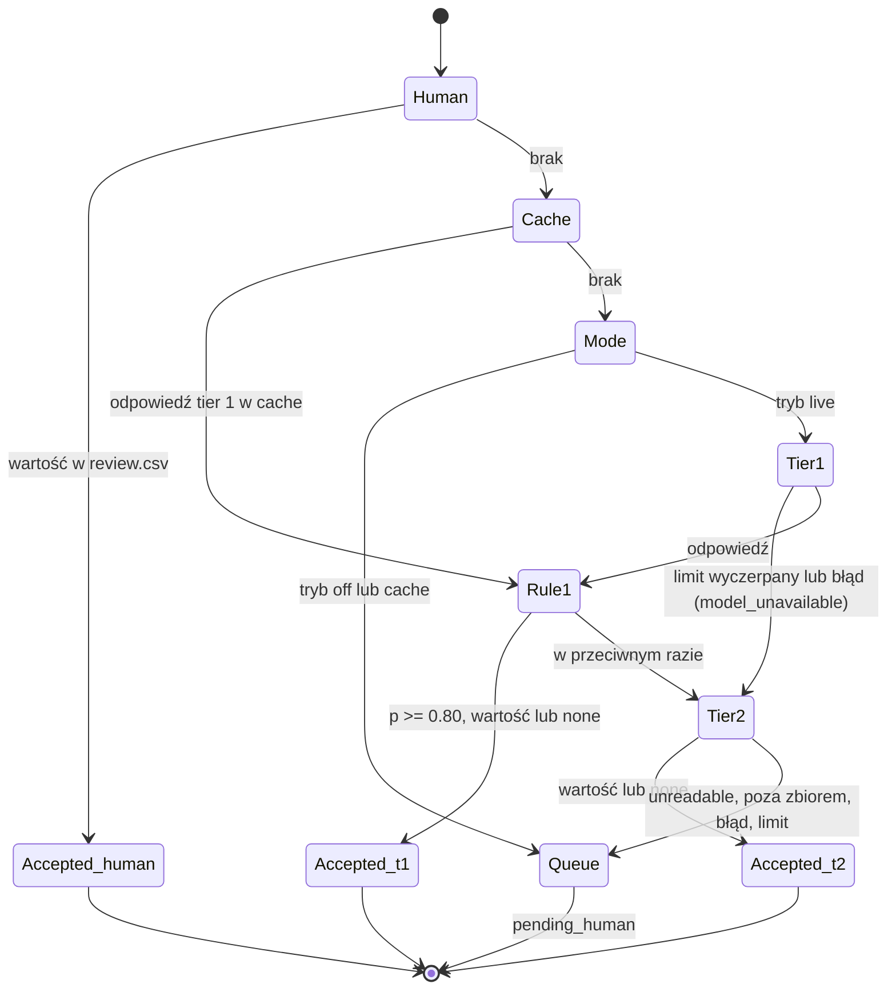
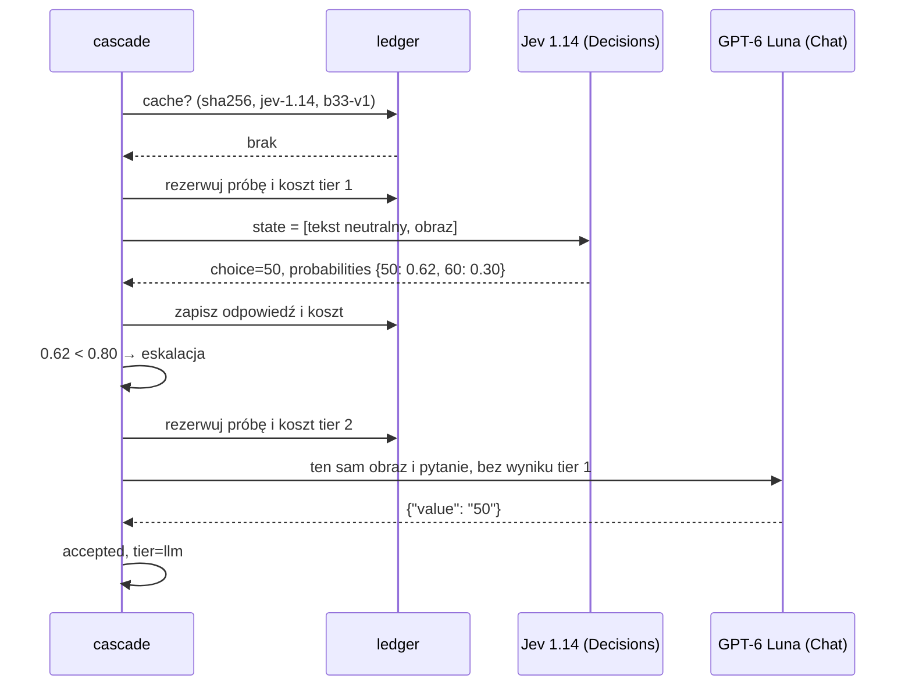
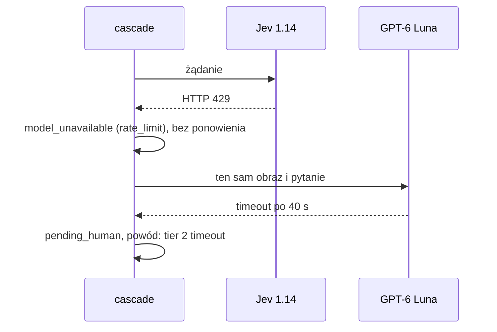

# ADR-001: Kaskada odczytu znaku: model decyzyjny → zwykły LLM → człowiek

**Data:** 2026-11-03
**Status:** Accepted
**Dotyczy:** [000-main-architecture.md](000-main-architecture.md); PRD §4.4–4.5, §11, §12, AC-08…AC-18, AC-32…AC-36

---

## 1. Zakres

Wybór modeli i klienta, kontrakt pytania, reguły przyjęcia i eskalacji, limity, timeout, cache, capture do mocków, ewaluacja. Nie obejmuje porównania z mapą (ADR-000, ADR-003) ani źródeł danych (ADR-002).

---

## 2. Dokumentacja (sprawdzona 2026-11-03)

| Źródło | Context7 ID lub link | Co potwierdzono |
|---|---|---|
| Decisions API | `/websites/openrouter_ai`; https://openrouter.ai/docs/guides/community/multimodal-decisions | `POST https://openrouter.ai/api/alpha/decisions` z polami `model`, `state`, `questions`. Obraz to element tablicy `state` w postaci `{"type":"image_url","image_url":{"url":"data:image/…;base64,…"}}`, a tekst w `state` to zwykły string |
| Typy pytań | https://openrouter.ai/docs/guides/community/jev | Pytanie `choice` ma `criteria` (etykieta → opis). Odpowiedź: `answers.<nazwa>.choice`, `probabilities`, `confidence`; schemat oznacza oba ostatnie pola jako opcjonalne. W odpowiedzi jest `usage.cost` |
| SDK Python | https://openrouter.ai/docs/client-sdks/python/sdks/decisions/README | `open_router.alpha.decisions.create` istnieje i ma parametr `retries`, który nadpisuje **domyślne ponowienia klienta** (strategia `backoff`) |
| Chat Completions | https://openrouter.ai/docs/api/api-reference/chat/create-a-chat-completion | `reasoning.effort` przyjmuje `medium`; `response_format` typu `json_schema` ze `strict` |
| Katalog modeli | `GET https://openrouter.ai/api/v1/models` (odczyt 2026-11-03) | Ceny i modalności w §3. Opóźnienia modeli decyzyjnych nie są publikowane (`latency_last_30m = null`) |

---

## 3. Modele

| Rola | Model | Wejście | Cena za 1M tokenów (2026-11-03) |
|---|---|---|---|
| Tier 1 | `typesafe/jev-1.14` | tekst, obraz; kontekst 262 144 | wejście 0,042 USD, wyjście 0 |
| Porównanie (tylko etap 1) | `openai/gpt-6-luna-decisions` | tekst, obraz; kontekst 1 050 000 | wejście 0,10 USD, wyjście 0 |
| Tier 2 | `openai/gpt-6-luna` | tekst, obraz; reasoning, structured outputs | wejście 0,10 USD, wyjście 0,50 USD |

Identyfikatory są w konfiguracji. Zmiana modelu zmienia klucz cache.

---

## 4. Kontrakt pytania

### Wersja

`question_version = b33-v1`. Każda zmiana treści pytania, etykiet lub schematu podnosi wersję. Wersja, próg i limity trafiają do `run.json` przed pierwszym wywołaniem etapu 2 i nie zmieniają się do jego końca (AC-14).

### Zbiór odpowiedzi (PRD §11)

- wartości: `5, 10, 15, 20, 25, 30, 35, 40, 45, 50, 55, 60, 65, 70, 75, 80, 90, 100, 110, 120, 130, 140`;
- `none`: na wycinku nie ma okrągłego B-33 (strefa, koniec strefy, koniec ograniczenia, inny znak, brak znaku);
- `unreadable`: B-33 jest widoczny, ale wartości nie da się odczytać.

### Tier 1: Decisions, pytanie `choice`

- `questions`: jedno pytanie `b33_value` typu `choice`, z neutralnymi `instructions` po angielsku i `criteria` z każdą etykietą i krótkim opisem.
- `state`: tablica z dokładnie dwoma elementami: stały tekst „Street-level photo crop.” oraz obraz wycinka jako data URL z bajtami pliku i typem MIME według rozszerzenia.
- **Do `state` nie trafia nic poza tym:** żadna nazwa pliku, `photo_id`, wartość mapy, `mapillary_value`, etykieta, obszar ani data (AC-13). Test kontraktu porównuje zbudowane ciało żądania z listą dozwolonych pól.

### Tier 2: Chat Completions

- Te same bajty obrazu i ta sama treść pytania. Bez odpowiedzi i rozkładu z tier 1 (AC-12).
- `reasoning.effort = medium`. Tok rozumowania nie trafia do wyników.
- `response_format = json_schema`, `strict`, z jednym polem `value` o wartości ze zbioru odpowiedzi (enum).

### Reguły przyjęcia (`accept-v1`)

| Tier | Przyjmuje | Eskaluje |
|---|---|---|
| 1 | `probabilities` jest obecne, najwyższe ≥ 0,80, a etykieta to wartość lub `none` | najwyższe < 0,80; etykieta `unreadable`; brak `probabilities`; `model_unavailable` |
| 2 | JSON zgodny ze schematem, `value` to wartość lub `none` | `unreadable`; niezgodność ze schematem; odpowiedź spoza zbioru; `model_unavailable` |

Brak `probabilities` nie jest zastępowany polem `confidence`. Próg 0,80 to wartość startowa z PRD. Eksplorację progów (AC-36) wykonuje się w trybie `cache` na zapisanych rozkładach i oznacza jako eksploracyjną.

---

## 5. Klient, limity, cache, capture

### Klient: surowy POST przez httpx

- Jeden `httpx.Client` dla obu endpointów: timeout 40 s, bez ponowień, bez przekierowań.
- `Authorization: Bearer` budowany z `OPENROUTER_API_KEY` w chwili wywołania. Kod sprawdza tylko obecność klucza, a jego wartość nie trafia do logów, wyjątków, capture ani wyników.
- Kategorie błędów: 400/413 → `bad_request`; 401/403 → `auth`; 402 → `payment`; 404 → `not_found`; 408/524/timeout → `timeout`; 429 → `rate_limit`; 5xx/529 → `provider`. Każdy błąd daje `model_unavailable` dla danego tieru, a znak idzie dalej kaskadą (PRD §4.7). Ponowienia nie ma.

### Limity (PRD §8)

| Model | Limit prób | Limit kosztu |
|---|---|---|
| Tier 1 (Jev) | 25 | z przydziału trenera |
| Porównanie (Luna Decisions) | 5, tylko etap 1 | z przydziału trenera |
| Tier 2 (Luna) | 10 | z przydziału trenera |

- Licznik rośnie **przed** wysłaniem żądania i obejmuje błędy, timeouty i capture (AC-15).
- Przed każdym żądaniem system rezerwuje koszt górny: rozmiar obrazu przeliczony na tokeny ostrożnym współczynnikiem plus pytanie, razy cena wejścia. Dla tier 2 dochodzi `max_tokens` razy cena wyjścia. Jeśli wykorzystany koszt plus rezerwacja przekroczyłby limit, żądanie nie jest wysyłane, a tier jest wyłączony do końca przebiegu.
- Po odpowiedzi rezerwację zastępuje `usage.cost`. Gdy tego pola brak, rezerwacja zostaje.
- `ledger.json` jest trwały dla `experiment_id`; wznowienie nie zeruje liczników.

### Cache

- Klucz: SHA-256 obrazu + identyfikator modelu + `question_version`. Próg nie należy do klucza (AC-16).
- Wartość: pełna surowa odpowiedź, `usage`, czas, status HTTP. Błędy nie są cache'owane.

### Capture do mocków

- Pierwsze realne żądanie do każdego modelu, wliczone w limit, zapisuje capture w `app/tests/fixtures/captures/`. Capture zawiera: datę, endpoint, model, wersję aplikacji, status, nagłówki odpowiedzi bez nagłówków uwierzytelniających i identyfikatorów konta oraz pełne ciało odpowiedzi bez zmian. W ciele żądania obraz jest zastąpiony znacznikiem `<image sha256=…>`.
- Mocki integracyjne czytają wyłącznie te pliki. Bez capture testy parsera danego endpointu są pomijane z przyczyną „brak capture”.

---

## 6. Decyzje techniczne

### Surowy POST przez httpx zamiast SDK `openrouter`
**Status:** Accepted
**Kontekst:** Endpoint Decisions jest w wersji alpha. SDK `openrouter` 1.3.107 wydano 2026-11-02, a jego metody domyślnie ponawiają żądania. PRD wymaga braku ponowień, stałego timeoutu i bezpiecznego capture.
**Decyzja:** httpx z jawną konfiguracją; jeden klient dla obu endpointów.
**Odrzucone:**
- SDK z `retries` wyłączonym: możliwe, ale domyślne ponowienia łatwo przywrócić przy zmianie wywołania, a typy wersji alpha zmieniają się między wydaniami.
- Klient OpenAI: wykluczony; nie obsługuje `/api/alpha/decisions`.
**Konsekwencje:** (+) brak ukrytych ponowień, capture 1:1; (−) własne parsowanie i mapowanie błędów.
**Wyzwalacz przeglądu:** Decisions API wychodzi z alpha.

### Jev 1.14 jako tier 1, Luna Decisions tylko porównawczo
**Status:** Accepted
**Kontekst:** Oba modele przyjmują obrazy i zwracają rozkład; Jev jest około 2,4 razy tańszy na token wejścia.
**Decyzja:** Jev w kaskadzie. Luna Decisions dostaje te same 5 wycinków etapu 1 z tym samym pytaniem, a wynik trafia do raportu porównawczego.
**Odrzucone:** Luna Decisions jako tier 1, bo jest droższa bez zmierzonej przewagi.
**Konsekwencje:** (+) niższy koszt; (−) wybór nie opiera się na pomiarze jakości.
**Wyzwalacz przeglądu:** w etapie 1 Luna Decisions ma więcej poprawnych przyjęć niż Jev przy zerze błędnych.

### GPT-6 Luna jako tier 2
**Status:** Accepted
**Kontekst:** Tier 2 ma być zwykłym LLM ze średnim rozumowaniem i obsługą obrazu; wybór wskazała użytkowniczka.
**Decyzja:** `openai/gpt-6-luna`, `reasoning.effort = medium`, strict `json_schema`.
**Odrzucone:**
- `anthropic/claude-haiku-5.5`: ta sama cena, odrzucony decyzją użytkowniczki.
- `anthropic/claude-sonnet-5.5`: 20 razy droższy.
**Konsekwencje:** (+) niski koszt, inny dostawca niż Jev; (−) ta sama rodzina co Luna Decisions, więc ich porównanie w etapie 1 nie jest niezależne. LLM nie zwraca skalibrowanego rozkładu, dlatego PRD przyjmuje każdą odpowiedź ze zbioru.
**Wyzwalacz przeglądu:** błędne przyjęcie tier 2 w etapie 2 albo zmiana tier 1 na model z rodziny Luna.

### Pewność z rozkładu, nie z deklaracji
**Status:** Accepted
**Kontekst:** Tekstowa deklaracja pewności nie jest weryfikowalna.
**Decyzja:** Tier 1 przyjmuje odpowiedź na podstawie `probabilities`. Tier 2 nie podaje pewności.
**Odrzucone:** pole „confidence” w schemacie tier 2.
**Konsekwencje:** (+) przewidywalne kryterium; (−) tier 2 może przyjąć błędny odczyt, co mierzy ewaluacja.
**Wyzwalacz przeglądu:** PRD fazy 2 wprowadzi eskalację przy niezgodności tierów.

---

## 7. Ewaluacja (PRD §12, AC-32…AC-36)

- `evaluate` czyta `signs/labels.csv` wyłącznie po przebiegu.
- Etykiety `uncertain` i `unreadable` są wyłączone z mianowników i liczone osobno.
- Baseline detektora: klasa `regulatory--maximum-speed-limit-N--…` → N; każda inna klasa lub brak klasy → `none`.
- Metryki per tier i dla całej kaskady: wysłane, przyjęte, eskalowane, błędy, trafność przyjętych, błędne przyjęcia, `none` lub eskalacja dla negatywów, żądania, koszt i koszt na przyjętą odpowiedź. Każda metryka ma jawny mianownik.
- Cele z PRD §12 są zapisane w konfiguracji ewaluacji przed etapem 1, a raport pokazuje „spełniony / niespełniony” bez dopasowywania progów.

---

## 8. Diagramy

### Stany

### Sekwencja: eskalacja

### Sekwencja: błąd usługi

---

## 9. Strategia testów

| Scenariusz | Typ | Wejście | Oczekiwany wynik | Przypadki brzegowe |
|---|---|---|---|---|
| Budowa żądań | unit | Sign | `state` = [tekst, obraz]; brak `photo_id`, ścieżki, `mapillary_value` | .jpg/.png |
| Reguła tier 1 | unit | rozkłady | przyjęcie tylko przy ≥ 0,80 i etykiecie ≠ `unreadable` | dokładnie 0,80; `none` 0,95; brak `probabilities` |
| Eskalacja do tier 2 | unit | niski rozkład + `{"value":"none"}` | `accepted`, `tier=llm` | odpowiedź spoza zbioru → kolejka |
| Limity i budżet | unit + integration | limit 1, dwa znaki | drugi: tier pominięty, `model_unavailable`, licznik w raporcie | rezerwacja ponad limit kosztu |
| Cache i wznowienie | integration | przebieg live (mock z capture), potem cache | drugi przebieg: 0 żądań, te same wyniki (AC-03) | zmiana progu: przeliczenie bez żądań |
| Błąd usługi | integration | 429, timeout | `model_unavailable`, znak idzie dalej, transport liczy 1 żądanie | błąd w obu tierach → kolejka |

E2E `live` dopiero po przyznaniu budżetu: najpierw po jednym żądaniu capture na model, potem etap 1 (5 znaków, Jev + Luna Decisions + tier 2), potem etap 2 i etap 3 w trybie `cache`.

### Techniczne kryteria akceptacji

- TAC-001-01: Transport testowy rejestruje dokładnie jedno żądanie na próbę; po błędzie brak kolejnego żądania do tego samego tieru dla tego znaku.
- TAC-001-02: Ciała żądań tier 1 i tier 2 zawierają wyłącznie pola z listy dozwolonych.
- TAC-001-03: Przebieg `cache` po `live` na tych samych znakach daje identyczne odczyty i zero żądań.
- TAC-001-04: `ledger.json` po wznowieniu sumuje próby z obu przebiegów.
- TAC-001-05: Capture nie zawiera nagłówka `Authorization` ani ciągu `base64,`.
