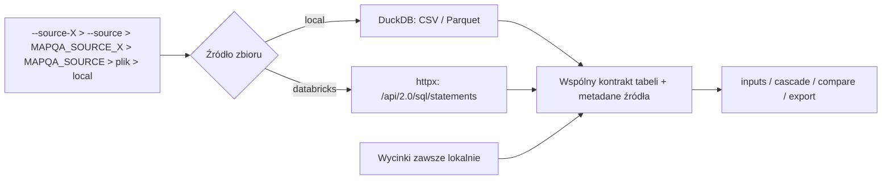
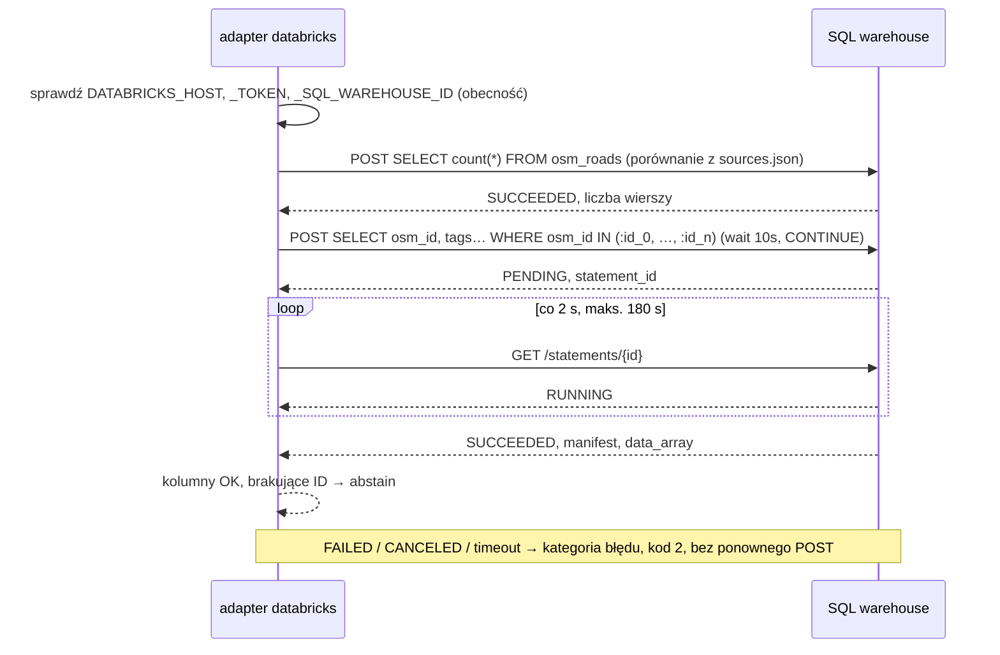

# ADR-002: Źródła danych (pliki, Databricks) i raporty

**Data:** 2026-11-03
**Status:** Accepted: pliki lokalne, Databricks przez REST, raport Markdown i pliki CSV. Proposed: Databricks CLI, raport HTML (faza 2).
**Dotyczy:** [000-main-architecture.md](000-main-architecture.md); PRD §4.6–4.7, AC-25…AC-31, AC-37…AC-44; [DATABRICKS.md](../../course-materials/exercise-data/map-qa/DATABRICKS.md)

---

## 1. Zakres

Adaptery źródeł danych, sposób wyboru źródła, kontrakt odczytu Databricks i format raportów. Nie obejmuje dashboardu, bo nie ma go w PRD.

---

## 2. Dokumentacja (sprawdzona 2026-11-03)

| Źródło | Context7 ID lub link | Co potwierdzono |
|---|---|---|
| SQL Statement Execution API | `/websites/databricks_api`; https://docs.databricks.com/aws/en/dev-tools/sql-execution-tutorial | `POST /api/2.0/sql/statements` przyjmuje `warehouse_id`, `statement`, `wait_timeout` (`0s` albo 5–50 s, domyślnie 10 s), `on_wait_timeout` (`CONTINUE` / `CANCEL`), `disposition` (`INLINE` do 25 MiB w JSON_ARRAY lub `EXTERNAL_LINKS`) i nazwane `parameters`. Status odpytujemy przez `GET /api/2.0/sql/statements/{id}`. Stany: PENDING, RUNNING, SUCCEEDED, FAILED, CANCELED, CLOSED. Odczyt statusu może trwać do 5 s |
| Databricks CLI | `/databricks/cli` | `databricks api post/get` opakowuje to samo REST API. **Na tej VM CLI nie jest zainstalowany** (`databricks: command not found`, 2026-11-03) |
| Dane w Databricks | `DATABRICKS.md`, `sources.json` | 5 tabel `workspace.map_qa`, geometria jako WKB bez SRID, wspólny token ma zakres `sql`. Managed MCP zwraca 403 dla tego tokenu |
| Jinja | `/websites/jinja_palletsprojects_en_stable` | `select_autoescape` dla HTML (faza 2) |
| Streamlit, PySide6 | https://docs.streamlit.io, https://doc.qt.io/qtforpython-6/ | Nieużywane: dashboard poza PRD |

---

## 3. Zbiory i źródła

| Zbiór | `local` | `databricks` |
|---|---|---|
| `osm_roads` | `osm_roads.parquet` | `workspace.map_qa.osm_roads` |
| `signs` | `signs/signs.csv` | — (tylko lokalnie) |
| `nearest_osm` | `signs/nearest_osm.csv` | — |
| `crops` | `signs/crops/` | — (obrazy zawsze lokalnie) |
| `labels` | `signs/labels.csv` | — (tylko ewaluator) |
| `source_meta` | `sources.json` | — |

Każdy adapter zwraca ten sam kontrakt: tabelę z nazwanymi, typowanymi kolumnami oraz metadane `dataset`, `source_kind`, `location`, `chosen_by` (`option` / `env` / `config` / `default`), `rows`, `snapshot_rows`, `read_at`. Dla Databricks dochodzi jeszcze `statement_id`.

### Wybór źródła (AC-37, AC-38)

Kolejność pierwszeństwa: `--source-<dataset>` > `--source` > `MAPQA_SOURCE_<DATASET>` > `MAPQA_SOURCE` > plik konfiguracji > `local`. Plik konfiguracji podaje dla każdego zbioru ścieżkę lub `catalog.schema.table`, a dla Databricks tylko **nazwy** zmiennych hosta, tokenu i warehouse. Walidacja sekretów (AC-40), bez heurystyk długości: pola z nazwami zmiennych mają sufiks `_env` (`host_env`, `token_env`, `warehouse_env`), a ich wartość musi pasować do wzorca `^[A-Z][A-Z0-9_]*$`. Plik jest odrzucany, jeśli zawiera pole o nazwie `token`, `api_key`, `secret` lub `password`, albo jeśli dowolna wartość tekstowa zaczyna się od `dapi`, `Bearer `, `sk-` lub `ctx7sk`. Komunikat podaje nazwę pola, bez wartości. Identyfikator warehouse i hashe są dozwolone. Nie ma automatycznego zastępstwa przy awarii (PRD §4.7).

### Kontrakt odczytu Databricks

- Warehouse zawsze jawny. Nie wybieramy pierwszego dostępnego, jak robi `query_databricks.py`.
- Zapytanie budowane z listy potrzebnych kolumn. Dla `osm_roads` to `osm_id`, `highway`, `tags` i kolumny `maxspeed*`, bez geometrii. Filtr to `osm_id IN (:id_0, :id_1, …)`, po jednym nazwanym markerze na identyfikator, każdy z typem kolumny `osm_id` z `manifest.schema`. Parametry Statement Execution API są skalarami, więc listy nie da się związać jednym markerem. Paczka liczy maksymalnie 256 identyfikatorów; MVP potrzebuje jednej paczki (≤ 119 dróg). Wartości nigdy nie są wklejane do tekstu SQL. Pobieramy tylko drogi wskazane w `nearest_osm`, więc wynik mieści się w INLINE.
- Nazwa tabeli z konfiguracji musi pasować do wzorca `catalog.schema.table` (tylko litery, cyfry, `_`).
- Strażnik: tekst zapytania zaczyna się od `SELECT` i nie zawiera `;`. Każde wysłane zapytanie trafia do logu przebiegu (AC-41).
- `wait_timeout = 10s`, `on_wait_timeout = CONTINUE`; potem polling po `statement_id` co 2 s do limitu 180 s. **Nigdy nie ponawiamy POST** w ramach przebiegu (PRD §4.7).
- Sprawdzamy obecność wymaganych kolumn.
- AC-43 dla obu źródeł działa tak samo: liczba wierszy **całej tabeli** jest porównywana z liczbą w `sources.json`. Lokalnie to liczba wierszy pliku, w Databricks osobne zapytanie `SELECT count(*)`. Różnica daje ostrzeżenie z obiema wartościami, a przebieg trwa dalej. Osobno raportujemy identyfikatory z `nearest_osm`, których nie znaleziono w tabeli; dostają `abstain` (ADR-003).
- Kategorie błędów: `missing_variable` (przed jakimkolwiek zapytaniem, AC-42), `auth` (401), `permission` (403), `query_failed` (FAILED, z `error_code`), `timeout`, `canceled`. Każdy błąd kończy przebieg kodem 2 przed wywołaniem modelu.

---

## 4. Raporty i pliki

| Plik | Status | Zawartość |
|---|---|---|
| `report.md` | Accepted | Kolejno: nagłówek, podsumowanie, kandydaci, kolejka ręczna, „nie da się porównać”, ewaluacja (AC-26). Puste sekcje: „0 pozycji” |
| `results.csv` | Accepted | Jeden wiersz na znak: odczyt, tier, wynik, surowe tagi OSM, powód abstencji |
| `review.csv` | Accepted | Kolumny z PRD §9.3. Scalanie: klucz `row_id = photo_id + row_type`, wartości wpisane przez ludzi nigdy nie są nadpisywane (AC-29) |
| `run.json` | Accepted | Parametry, źródła, wersje, hashe wejść, liczniki, log zapytań SQL |
| `report.html` | Proposed (faza 2) | Jinja2 3.1.6 z `select_autoescape(["html"])`, miniatury ze ścieżkami względnymi |

Wymagania wspólne:
- Liczniki raportu i CSV pochodzą z jednej struktury danych.
- Nagłówek zawiera zdanie z AC-28.
- Przy każdym linku do obrazu jest autor, źródło i licencja (AC-27).
- Ścieżki są względne; pliki nie zawierają base64 ani sekretów.
- Markdown escapuje znaki specjalne w tekstach z danych (`|`, `<`, `` ` ``).

---

## 5. Decyzje techniczne

### Databricks przez REST (httpx), CLI odłożony
**Status:** Accepted (REST), Proposed (CLI)
**Kontekst:** PRD AC-39 wymaga odczytu `osm_roads` z Databricks. Dostępne są REST, CLI, `databricks-sql-connector` i MCP.
**Decyzja:** REST SQL Statement Execution API przez ten sam `httpx.Client` co w ADR-001.
**Odrzucone:**
- Databricks CLI (subprocess): nie jest zainstalowany na VM, a wywołuje to samo API. Zostaje jako możliwy drugi adapter z identycznym ciałem żądania.
- `databricks-sql-connector` (`/databricks/databricks-sql-python`): inny protokół i własne ponowienia, a mamy zakaz ukrytych ponowień.
- MCP: wspólny token z zakresem `sql` dostaje 403. MCP służy agentom do eksploracji, nie jest źródłem danych narzędzia.
**Konsekwencje:** (+) jedna zależność HTTP, wspólne testy z capture; (−) polling i kategorie błędów trzeba napisać samemu.
**Wyzwalacz przeglądu:** wynik przekracza 25 MiB albo organizacja wymaga CLI.

### Tylko potrzebne kolumny i wiersze z Databricks
**Status:** Accepted
**Kontekst:** `osm_roads` ma 99 768 wierszy z geometrią WKB, a INLINE ma limit 25 MiB. Każde zapytanie może uruchomić współdzielony warehouse.
**Decyzja:** Jedno zapytanie na przebieg, z projekcją kolumn tagów i filtrem po identyfikatorach z `nearest_osm`.
**Odrzucone:** pobranie całej tabeli z `EXTERNAL_LINKS`, bo to wolniejsze i wymaga obsługi linków.
**Konsekwencje:** (+) mały wynik, szybki odczyt; (−) faza 2 (geometria) będzie wymagała `EXTERNAL_LINKS` albo filtra przestrzennego.
**Wyzwalacz przeglądu:** faza 2.

### Markdown bez szablonów, HTML z Jinja2
**Status:** Accepted (Markdown), Proposed (HTML)
**Kontekst:** MVP wymaga tylko Markdown i CSV. HTML z danymi zewnętrznymi wymaga escapowania.
**Decyzja:** Markdown składany w Pythonie. HTML dopiero w fazie 2, z Jinja2 i autoescape.
**Odrzucone:** HTML w czystym Pythonie, bo ręczne escapowanie to typowe źródło XSS.
**Konsekwencje:** (+) zero nowych zależności w MVP; (−) w fazie 2 będą dwa sposoby generowania raportów.
**Wyzwalacz przeglądu:** HTML w PRD.

### Dashboard: brak decyzji
**Status:** Proposed (odroczone)
Notatka na przyszłość: Streamlit to szybki prototyp w przeglądarce, ale wymaga uruchomionego serwera. PySide6 to aplikacja desktopowa bez serwera, ale z większym kosztem implementacji.

---

## 6. Diagramy

---

## 7. Strategia testów

| Scenariusz | Typ | Wejście | Oczekiwany wynik | Przypadki brzegowe |
|---|---|---|---|---|
| Pierwszeństwo źródeł | unit | sprzeczne opcja, zmienna, plik | wygrywa opcja; `chosen_by` poprawne | nic nie ustawione → `local` |
| Sekret w konfiguracji | unit | pole `token`; wartość `dapi…`; `token_env` = `dapi…` | odrzucenie z nazwą pola, wartość nie w komunikacie | `warehouse_id = 97c455ee6fb1fcb9` i hash SHA-256 są akceptowane |
| Parametry Databricks | unit | 95 identyfikatorów | 95 markerów `:id_n`, wartości tylko w `parameters`, nie w tekście SQL | 257 identyfikatorów → dwie paczki |
| Strażnik SELECT | unit | `DELETE …`, `SELECT …; DROP …` | odrzucone przed wysłaniem | wielkość liter, komentarze SQL |
| Polling | integration (mock z capture) | PENDING → RUNNING → SUCCEEDED | jeden POST, n GET | FAILED, timeout 180 s |
| Brak zmiennej | unit | brak `DATABRICKS_TOKEN` | kod 2, nazwa zmiennej, zero żądań | pusty host |
| Zgodność źródeł | e2e | `osm_roads` z Databricks vs lokalnie | identyczne wyniki i liczniki (AC-39) | — |
| Scalanie review | unit | istniejący `review.csv` + nowe wiersze | wpisy ludzi niezmienione | usunięty znak z wejścia |
| Escapowanie | unit | tag z `<script>` i `|` | tekst, nie znacznik; tabela nieuszkodzona | zero kandydatów |

Mock Databricks powstaje z capture realnego zapytania `SELECT … LIMIT 5` na `workspace.map_qa.osm_roads`, zapisanego jak w ADR-001 §5, bez tokenu i hosta.

### Techniczne kryteria akceptacji

- TAC-002-01: Przebieg z `osm_roads` z Databricks daje te same `results.csv` (poza kolumnami źródła) co przebieg lokalny.
- TAC-002-02: Log przebiegu zawiera dokładnie jeden POST na zapytanie i wyłącznie instrukcje `SELECT`.
- TAC-002-03: `--dry-run` kończy się kodem 0 bez żadnego żądania HTTP i bez odczytu plików danych (AC-44).
- TAC-002-04: Wartość `DATABRICKS_TOKEN` nie występuje w żadnym pliku wynikowym ani logu (test skanujący).
