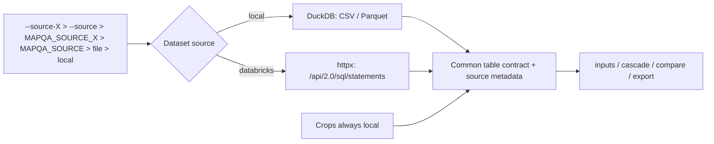
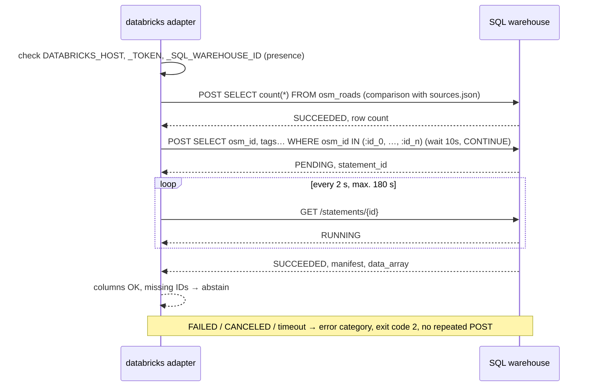

# ADR-002: Data sources (files, Databricks) and reports

**Date:** 2026-11-03
**Status:** Accepted: local files, Databricks via REST, Markdown report and CSV files. Proposed: Databricks CLI, HTML report (phase 2).
**Relates to:** [000-main-architecture.md](000-main-architecture.md); PRD §4.6–4.7, AC-25…AC-31, AC-37…AC-44; [DATABRICKS.md](../../course-materials/exercise-data/map-qa/DATABRICKS.md)

---

## 1. Scope

Data source adapters, how the source is selected, the Databricks read contract and the report format. It does not cover a dashboard, because the PRD has none.

---

## 2. Documentation (checked 2026-11-03)

| Source | Context7 ID or link | What was confirmed |
|---|---|---|
| SQL Statement Execution API | `/websites/databricks_api`; https://docs.databricks.com/aws/en/dev-tools/sql-execution-tutorial | `POST /api/2.0/sql/statements` accepts `warehouse_id`, `statement`, `wait_timeout` (`0s` or 5–50 s, default 10 s), `on_wait_timeout` (`CONTINUE` / `CANCEL`), `disposition` (`INLINE` up to 25 MiB in JSON_ARRAY, or `EXTERNAL_LINKS`) and named `parameters`. Status is polled via `GET /api/2.0/sql/statements/{id}`. States: PENDING, RUNNING, SUCCEEDED, FAILED, CANCELED, CLOSED. A status read can take up to 5 s |
| Databricks CLI | `/databricks/cli` | `databricks api post/get` wraps the same REST API. **The CLI is not installed on this VM** (`databricks: command not found`, 2026-11-03) |
| Data in Databricks | `DATABRICKS.md`, `sources.json` | 5 tables in `workspace.map_qa`, geometry as WKB without SRID, the shared token has `sql` scope. Managed MCP returns 403 for this token |
| Jinja | `/websites/jinja_palletsprojects_en_stable` | `select_autoescape` for HTML (phase 2) |
| Streamlit, PySide6 | https://docs.streamlit.io, https://doc.qt.io/qtforpython-6/ | Not used: dashboard is outside the PRD |

---

## 3. Datasets and sources

| Dataset | `local` | `databricks` |
|---|---|---|
| `osm_roads` | `osm_roads.parquet` | `workspace.map_qa.osm_roads` |
| `signs` | `signs/signs.csv` | — (local only) |
| `nearest_osm` | `signs/nearest_osm.csv` | — |
| `crops` | `signs/crops/` | — (images always local) |
| `labels` | `signs/labels.csv` | — (evaluator only) |
| `source_meta` | `sources.json` | — |

Every adapter returns the same contract: a table with named, typed columns plus the metadata `dataset`, `source_kind`, `location`, `chosen_by` (`option` / `env` / `config` / `default`), `rows`, `snapshot_rows`, `read_at`. For Databricks, `statement_id` is added.

### Source selection (AC-37, AC-38)

Order of precedence: `--source-<dataset>` > `--source` > `MAPQA_SOURCE_<DATASET>` > `MAPQA_SOURCE` > config file > `local`. The config file gives, for each dataset, a path or `catalog.schema.table`, and for Databricks only the **names** of the host, token and warehouse variables. Secret validation (AC-40), without length heuristics: fields holding variable names have the suffix `_env` (`host_env`, `token_env`, `warehouse_env`), and their value must match the pattern `^[A-Z][A-Z0-9_]*$`. The file is rejected if it contains a field named `token`, `api_key`, `secret` or `password`, or if any string value starts with `dapi`, `Bearer `, `sk-` or `ctx7sk`. The message gives the field name, without the value. The warehouse ID and hashes are allowed. There is no automatic fallback on failure (PRD §4.7).

### Databricks read contract

- The warehouse is always explicit. We do not pick the first available one, as `query_databricks.py` does.
- The query is built from the list of required columns. For `osm_roads` these are `osm_id`, `highway`, `tags` and the `maxspeed*` columns, without geometry. The filter is `osm_id IN (:id_0, :id_1, …)`, with one named marker per ID, each typed with the type of the `osm_id` column from `manifest.schema`. Statement Execution API parameters are scalars, so a list cannot be bound to a single marker. A batch holds at most 256 IDs; the MVP needs one batch (≤ 119 roads). Values are never pasted into the SQL text. We fetch only the roads referenced in `nearest_osm`, so the result fits in INLINE.
- The table name from the config must match the pattern `catalog.schema.table` (letters, digits and `_` only).
- Guard: the query text starts with `SELECT` and contains no `;`. Every query sent goes into the run log (AC-41).
- `wait_timeout = 10s`, `on_wait_timeout = CONTINUE`; then polling by `statement_id` every 2 s up to a 180 s limit. **We never retry the POST** within a run (PRD §4.7).
- We check that the required columns are present.
- AC-43 works the same for both sources: the row count of the **whole table** is compared with the count in `sources.json`. Locally this is the file's row count; in Databricks a separate `SELECT count(*)` query. A difference produces a warning with both values, and the run continues. Separately, we report IDs from `nearest_osm` that were not found in the table; they get `abstain` (ADR-003).
- Error categories: `missing_variable` (before any query, AC-42), `auth` (401), `permission` (403), `query_failed` (FAILED, with `error_code`), `timeout`, `canceled`. Every error ends the run with exit code 2 before the model is called.

---

## 4. Reports and files

| File | Status | Content |
|---|---|---|
| `report.md` | Accepted | In order: header, summary, candidates, manual queue, „nie da się porównać” (cannot be compared), evaluation (AC-26). Empty sections: „0 pozycji” (0 items) |
| `results.csv` | Accepted | One row per sign: reading, tier, result, raw OSM tags, abstention reason |
| `review.csv` | Accepted | Columns from PRD §9.3. Merging: key `row_id = photo_id + row_type`; values entered by people are never overwritten (AC-29) |
| `run.json` | Accepted | Parameters, sources, versions, input hashes, counters, SQL query log |
| `report.html` | Proposed (phase 2) | Jinja2 3.1.6 with `select_autoescape(["html"])`, thumbnails with relative paths |

Common requirements:
- Report and CSV counters come from one data structure.
- The header contains the sentence from AC-28.
- Every image link is accompanied by author, source and license (AC-27).
- Paths are relative; files contain no base64 and no secrets.
- Markdown escapes special characters in text from data (`|`, `<`, `` ` ``).

---

## 5. Technical decisions

### Databricks via REST (httpx), CLI deferred
**Status:** Accepted (REST), Proposed (CLI)
**Context:** PRD AC-39 requires reading `osm_roads` from Databricks. REST, CLI, `databricks-sql-connector` and MCP are available.
**Decision:** REST SQL Statement Execution API through the same `httpx.Client` as in ADR-001.
**Rejected:**
- Databricks CLI (subprocess): not installed on the VM, and it calls the same API. It remains a possible second adapter with an identical request body.
- `databricks-sql-connector` (`/databricks/databricks-sql-python`): a different protocol with its own retries, and hidden retries are forbidden.
- MCP: the shared token with `sql` scope gets 403. MCP serves agents for exploration; it is not a data source for the tool.
**Consequences:** (+) one HTTP dependency, shared tests from captures; (−) polling and error categories must be written by hand.
**Review trigger:** the result exceeds 25 MiB or the organization requires the CLI.

### Only the required columns and rows from Databricks
**Status:** Accepted
**Context:** `osm_roads` has 99 768 rows with WKB geometry, and INLINE has a 25 MiB limit. Each query may start the shared warehouse.
**Decision:** One query per run, projecting the tag columns and filtering by the IDs from `nearest_osm`.
**Rejected:** fetching the whole table with `EXTERNAL_LINKS`, because it is slower and requires link handling.
**Consequences:** (+) small result, fast read; (−) phase 2 (geometry) will require `EXTERNAL_LINKS` or a spatial filter.
**Review trigger:** phase 2.

### Markdown without templates, HTML with Jinja2
**Status:** Accepted (Markdown), Proposed (HTML)
**Context:** The MVP requires only Markdown and CSV. HTML with external data requires escaping.
**Decision:** Markdown assembled in Python. HTML only in phase 2, with Jinja2 and autoescape.
**Rejected:** HTML in plain Python, because manual escaping is a typical source of XSS.
**Consequences:** (+) zero new dependencies in the MVP; (−) in phase 2 there will be two ways of generating reports.
**Review trigger:** HTML in the PRD.

### Dashboard: no decision
**Status:** Proposed (deferred)
Note for the future: Streamlit is a fast browser prototype but needs a running server. PySide6 is a desktop application without a server, but with a higher implementation cost.

---

## 6. Diagrams

---

## 7. Test strategy

| Scenario | Type | Input | Expected result | Edge cases |
|---|---|---|---|---|
| Source precedence | unit | conflicting option, variable, file | option wins; `chosen_by` correct | nothing set → `local` |
| Secret in config | unit | field `token`; value `dapi…`; `token_env` = `dapi…` | rejected with field name, value not in message | `warehouse_id = 97c455ee6fb1fcb9` and a SHA-256 hash are accepted |
| Databricks parameters | unit | 95 IDs | 95 `:id_n` markers, values only in `parameters`, not in SQL text | 257 IDs → two batches |
| SELECT guard | unit | `DELETE …`, `SELECT …; DROP …` | rejected before sending | letter case, SQL comments |
| Polling | integration (mock from capture) | PENDING → RUNNING → SUCCEEDED | one POST, n GETs | FAILED, 180 s timeout |
| Missing variable | unit | no `DATABRICKS_TOKEN` | exit code 2, variable name, zero requests | empty host |
| Source parity | e2e | `osm_roads` from Databricks vs local | identical results and counters (AC-39) | — |
| Review merge | unit | existing `review.csv` + new rows | people's entries unchanged | sign removed from input |
| Escaping | unit | tag with `<script>` and `|` | text, not markup; table intact | zero candidates |

The Databricks mock is built from a capture of a real `SELECT … LIMIT 5` query on `workspace.map_qa.osm_roads`, saved as in ADR-001 §5, without the token and host.

### Technical acceptance criteria

- TAC-002-01: A run with `osm_roads` from Databricks produces the same `results.csv` (apart from the source columns) as a local run.
- TAC-002-02: The run log contains exactly one POST per query and only `SELECT` statements.
- TAC-002-03: `--dry-run` exits with code 0 without any HTTP request and without reading data files (AC-44).
- TAC-002-04: The value of `DATABRICKS_TOKEN` does not appear in any output file or log (scanning test).
