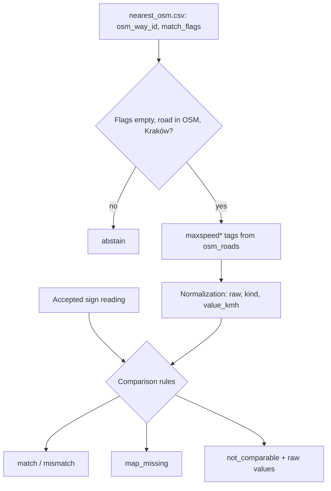
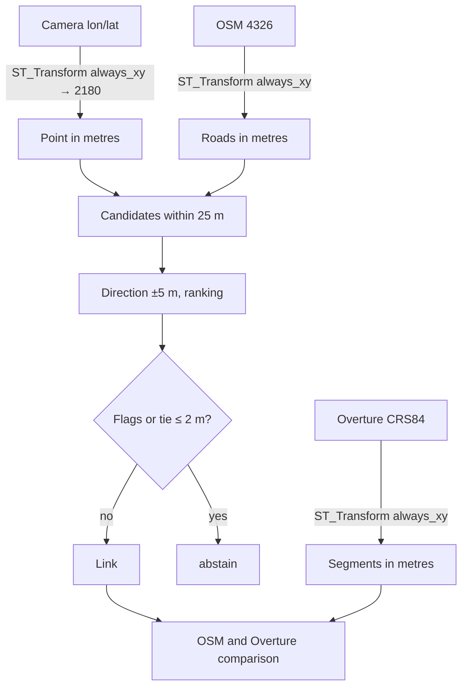

# ADR-003: Speed normalization, photo-to-road linking and spatial computations

**Date:** 2026-11-03
**Status:**
- Accepted (MVP): normalization of OSM `maxspeed*` and comparison rules (PRD AC-19…AC-23), abstention based on flags from `nearest_osm.csv`.
- Proposed (phase 2): spatial engine, EPSG:2180, own photo-to-road linking, Overture `speed_limits`.

**Relates to:** [000-main-architecture.md](000-main-architecture.md); PRD §7, §11, §13

---

## 1. Scope

In the MVP, the sign-to-road link comes from `signs/nearest_osm.csv`, and geometry is not computed (PRD §7). This ADR already defines how to normalize speeds. It also prepares phase 2: computations in metres, own matching and Overture.

---

## 2. Documentation (checked 2026-11-03)

| Source | Context7 ID or link | What was confirmed |
|---|---|---|
| DuckDB spatial | `/websites/duckdb_current`; https://duckdb.org/docs/stable/core_extensions/spatial/overview | The function has the form `ST_Transform(geom, source_crs, target_crs, always_xy)`. EPSG:4326 defines the axis order as [lat, lon], so lon/lat data needs `always_xy := true`. DuckDB has its own copy of the PROJ database |
| GeoPandas | `/geopandas/geopandas`; https://geopandas.org/en/stable/docs.html | `sjoin_nearest` has `max_distance` and `distance_col`. Distances require a projected CRS |
| Data | `course-materials/exercise-data/map-qa/README.md`, `sources.json` | Candidate ranking rule, 25 m radius, meaning of flags |

Facts from the data: OSM has 99 768 roads in EPSG:4326. Directional and conditional tags are rare: 261 `:forward`, 247 `:backward`, 92 `:conditional`. Overture has 85 405 segments with no declared CRS (the source states CRS84, i.e. lon/lat). 12 847 segments have speed rules, including 911 with multiple rules. `speed_limits` is a list of structs `max_speed {value, unit}`, `min_speed`, `is_max_speed_variable`, `when {heading, during, using[], recognized[], …}`, `between [from, to]`.

---

## 3. MVP: OSM normalization and comparison

### Normalization of `maxspeed*` tags (Accepted)

Each road gets a list of rules. Fields of each rule:
- `source_tag`: `maxspeed`, `maxspeed:forward`, `maxspeed:backward` or `maxspeed:conditional`;
- `raw`: the exact tag text, unchanged;
- `kind`, `value_kmh`, `unit_raw`, `condition_raw`.

`kind` values:

| `kind` | Example | `value_kmh` |
|---|---|---|
| `numeric` | `50`, `50 km/h` | number in km/h |
| `numeric_other_unit` | `30 mph`, `20 knots` | empty; `unit_raw` kept; no conversion, because comparison requires km/h (AC-20) |
| `implicit` | `PL:urban`, `PL:rural`, `PL:motorway` | empty; no guessing of the statutory limit |
| `special` | `none`, `signals`, `walk`, `variable` | empty |
| `multi` | `50;70` | separate rules with the `multi_value` flag |
| `conditional` | `60 @ (22:00-06:00)` | number before `@`; text after `@` in `condition_raw` |

An empty tag means no rule, never 0. Text that cannot be recognized gets `kind = unparsed` and keeps `raw`.

### Comparison rules (Accepted, PRD AC-20…AC-24)

| Outcome | Condition |
|---|---|
| `abstain` | non-empty `match_flags` in `nearest_osm.csv`, road absent from `osm_roads`, or `area ≠ Kraków` |
| `pending_human` | no accepted reading value |
| `not_comparable` | reading `none`, or any `:forward` / `:backward` / `:conditional` tag is present, or `maxspeed` has a `kind` other than `numeric` |
| `map_missing` | numeric reading and all four tags absent |
| `match` / `mismatch` | numeric reading, only `maxspeed` with `kind = numeric`, values equal / different |

A comparison outcome never means a map error. Only an analyst can issue the `confirmed` verdict.

---

## 4. Phase 2 (Proposed)

### Engine: DuckDB spatial; GeoPandas only for cross-checking
**Status:** Proposed
**Context:** We will need transformation to metres, candidates within a radius and the local road direction; about 100k lines and a few hundred points.
**Decision:** DuckDB spatial in the same version as for reading. GeoPandas 1.2.0, Shapely 2.2.0 and pyproj 3.8.0 only in tests, as an independent distance computation on a sample.
**Rejected:**
- GeoPandas as the main engine: a second data model alongside SQL; we need all candidates within 25 m, not only the nearest one.
- Computations in degrees: they give wrong distances.
**Consequences:** (+) SQL portable to Databricks, which also has `ST_Transform`; (−) axis order requires discipline. DuckDB and pyproj have separate copies of PROJ, so the cross-check allows a tolerance of 0.01 m.
**Review trigger:** DuckDB vs pyproj discrepancy above 0.01 m.

### CRS: EPSG:2180, explicit axis order
**Status:** Proposed
**Decision:** Camera points, OSM and Overture are transformed from lon/lat to EPSG:2180 with `always_xy := true`. Overture is treated explicitly as CRS84, and we do not guess the CRS from metadata. Distance column names include the unit and CRS, e.g. `distance_m_2180`.
**Rejected:**
- EPSG:3857: overstates distances by about 1.55 times at Kraków's latitude.
- UTM 34N: correct, but inconsistent with the exercise data.
**Review trigger:** data outside the EPSG:2180 extent.

### Photo-to-road linking
**Status:** Proposed
**Decision:**
1. Candidates: all roads within 25 m of the camera in EPSG:2180.
2. Local road direction: the tangent within ±5 m of the camera's projection onto the road.
3. Direction difference: undirected in the 0–90° range, and separately directed in the 0–180° range relative to node order.
4. Ranking as in `sources.json`: `distance_m + difference/9`. Missing heading adds 5 m. `heading = 0.0` is north.
5. Tie: an alternative within ranking distance ≤ 2 m gives `ambiguous_candidates` and `abstain`.
6. `abstain` is also caused by: `highway=service`; `access` or `motor_vehicle` ∈ {no, private, destination}; missing heading; panorama; a `layer`, `bridge` or `tunnel` different from the best candidate's; no road within 25 m.
7. Camera direction is not the direction of travel. Camera position is not the sign position.
8. A disagreement with the input `osm_way_id` is reported as `link_disagreement` and is not fixed.

### Overture `speed_limits`
**Status:** Proposed
**Decision:** Each list element is a separate row with the fields `rule_index`, `max_value`, `max_unit`, `min_value`, `min_unit`, `is_max_speed_variable`, `when_raw` (full JSON), `between_from`, `between_to`, `segment_id`, `sources`. A rule is unconditional only when `when` is empty and `between` is empty or equal to `[0, 1]`. We compare only against a single unconditional numeric rule; other cases give `not_comparable` with the raw values.
**Rejected:** reading only the first list element, because it skips the conditions in 911 segments.

---

## 5. Diagrams

### MVP

### Phase 2

---

## 6. Test strategy

| Scenario | Type | Input | Expected outcome | Edge cases |
|---|---|---|---|---|
| `maxspeed` normalization | unit | `50`, `50 km/h`, `30 mph`, `PL:urban`, `none`, `50;70`, `60 @ (22:00-06:00)`, empty, `abc` | `kind` and `value_kmh` as in §3, `raw` unchanged | empty ≠ 0; `30 mph` + reading 50 → `not_comparable`, not `mismatch` |
| Comparison | unit | reading 50 + `maxspeed=50`; + `maxspeed=40`; + no tags; + `:forward=50` | `match`; `mismatch`; `map_missing`; `not_comparable` | reading `none` |
| Abstention | integration | real `nearest_osm.csv` rows with flags | `abstain` with the flag as the reason | road absent from local OSM (4 cases) |
| Expected counts (MVP phase, from PRD §12) | integration, evaluation only | 74 numeric Kraków labels as readings | 13 `match`, 18 `mismatch`, 7 `map_missing`, 7 `not_comparable` | test in the `evaluate` module, not in the run path |
| Phase 2: known distance | integration | point and line in EPSG:2180 | agreement with GeoPandas within 0.01 m | deliberately swapped axes → the test must fail |
| Phase 2: heading 359 vs 1, reversed geometry | unit | angles, `oneway=-1` | 2° difference; undirected unchanged | empty heading |
| Phase 2: Overture | unit | segment with 3 rules | 3 rows, one unconditional | `between = [0, 1]` |

### Technical acceptance criteria

- TAC-003-01: Every rule has `raw` equal to the source tag value byte for byte.
- TAC-003-02: The count test from PRD §12 gives 13 / 18 / 7 / 7 when labels are substituted as readings (it checks the comparison logic, not model quality).
- TAC-003-03 (phase 2): The number of Overture rule rows equals the sum of the `speed_limits` list lengths.
- TAC-003-04 (phase 2): Recomputed distances for roads present in local OSM differ from `nearest_osm.csv` by at most 0.001 m.
