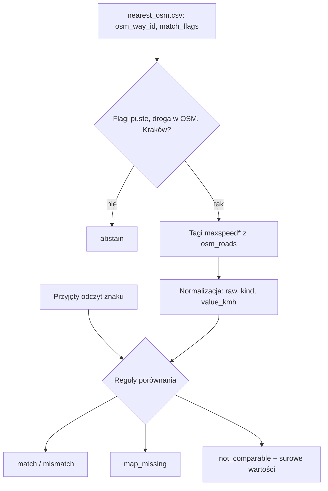
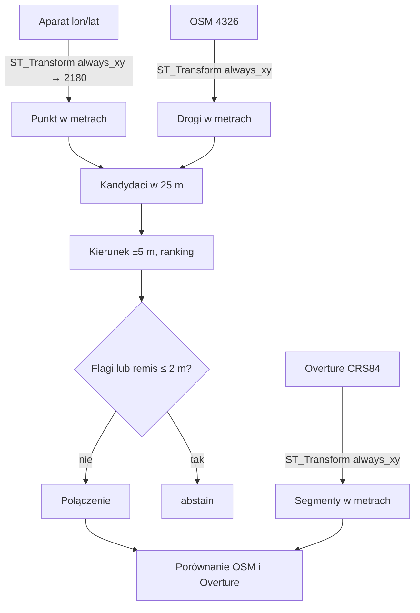

# ADR-003: Normalizacja prędkości, łączenie zdjęcia z drogą i obliczenia przestrzenne

**Data:** 2026-11-03
**Status:**
- Accepted (MVP): normalizacja OSM `maxspeed*` i reguły porównania (PRD AC-19…AC-23), abstencja na podstawie flag z `nearest_osm.csv`.
- Proposed (faza 2): silnik przestrzenny, EPSG:2180, własne łączenie zdjęcia z drogą, Overture `speed_limits`.

**Dotyczy:** [000-main-architecture.md](000-main-architecture.md); PRD §7, §11, §13

---

## 1. Zakres

W MVP połączenie znaku z drogą pochodzi z `signs/nearest_osm.csv`, a geometria nie jest liczona (PRD §7). Ten ADR ustala już teraz, jak normalizować prędkości. Przygotowuje też fazę 2: obliczenia w metrach, własne dopasowanie i Overture.

---

## 2. Dokumentacja (sprawdzona 2026-11-03)

| Źródło | Context7 ID lub link | Co potwierdzono |
|---|---|---|
| DuckDB spatial | `/websites/duckdb_current`; https://duckdb.org/docs/stable/core_extensions/spatial/overview | Funkcja ma postać `ST_Transform(geom, source_crs, target_crs, always_xy)`. EPSG:4326 ma w definicji kolejność [lat, lon], więc dla danych lon/lat potrzebne jest `always_xy := true`. DuckDB ma własną kopię bazy PROJ |
| GeoPandas | `/geopandas/geopandas`; https://geopandas.org/en/stable/docs.html | `sjoin_nearest` ma `max_distance` i `distance_col`. Odległości wymagają CRS rzutowanego |
| Dane | `course-materials/exercise-data/map-qa/README.md`, `sources.json` | Reguła rankingu kandydatów, promień 25 m, znaczenie flag |

Fakty z danych: OSM ma 99 768 dróg w EPSG:4326. Tagi kierunkowe i warunkowe występują rzadko: 261 `:forward`, 247 `:backward`, 92 `:conditional`. Overture ma 85 405 segmentów bez zadeklarowanego CRS (źródło podaje CRS84, czyli lon/lat). Reguły prędkości ma 12 847 segmentów, w tym 911 z wieloma regułami. `speed_limits` to lista struktur `max_speed {value, unit}`, `min_speed`, `is_max_speed_variable`, `when {heading, during, using[], recognized[], …}`, `between [od, do]`.

---

## 3. MVP: normalizacja OSM i porównanie

### Normalizacja tagów `maxspeed*` (Accepted)

Każda droga dostaje listę reguł. Pola każdej reguły:
- `source_tag`: `maxspeed`, `maxspeed:forward`, `maxspeed:backward` albo `maxspeed:conditional`;
- `raw`: dokładny tekst tagu, bez zmian;
- `kind`, `value_kmh`, `unit_raw`, `condition_raw`.

Wartości `kind`:

| `kind` | Przykład | `value_kmh` |
|---|---|---|
| `numeric` | `50`, `50 km/h` | liczba w km/h |
| `numeric_other_unit` | `30 mph`, `20 knots` | puste; `unit_raw` zachowane; bez przeliczania, bo porównanie wymaga km/h (AC-20) |
| `implicit` | `PL:urban`, `PL:rural`, `PL:motorway` | puste; bez zgadywania limitu ustawowego |
| `special` | `none`, `signals`, `walk`, `variable` | puste |
| `multi` | `50;70` | osobne reguły z flagą `multi_value` |
| `conditional` | `60 @ (22:00-06:00)` | liczba sprzed `@`; tekst po `@` w `condition_raw` |

Pusty tag oznacza brak reguły, nigdy 0. Tekst, którego nie da się rozpoznać, dostaje `kind = unparsed` i zachowuje `raw`.

### Reguły porównania (Accepted, PRD AC-20…AC-24)

| Wynik | Warunek |
|---|---|
| `abstain` | niepusty `match_flags` w `nearest_osm.csv`, droga nieobecna w `osm_roads` albo `area ≠ Kraków` |
| `pending_human` | brak przyjętej wartości odczytu |
| `not_comparable` | odczyt `none`, albo jest którykolwiek tag `:forward` / `:backward` / `:conditional`, albo `maxspeed` ma `kind` inny niż `numeric` |
| `map_missing` | odczyt liczbowy i brak wszystkich czterech tagów |
| `match` / `mismatch` | odczyt liczbowy, tylko `maxspeed` z `kind = numeric`, wartości równe / różne |

Wynik porównania nigdy nie oznacza błędu mapy. Werdykt `confirmed` może wydać wyłącznie analityk.

---

## 4. Faza 2 (Proposed)

### Silnik: DuckDB spatial; GeoPandas tylko do kontroli krzyżowej
**Status:** Proposed
**Kontekst:** Potrzebne będą transformacja do metrów, kandydaci w promieniu i lokalny kierunek drogi; około 100 tys. linii i kilkaset punktów.
**Decyzja:** DuckDB spatial w tej samej wersji co odczyt. GeoPandas 1.2.0, Shapely 2.2.0 i pyproj 3.8.0 tylko w testach, jako niezależne wyliczenie dystansu na próbce.
**Odrzucone:**
- GeoPandas jako silnik główny: drugi model danych obok SQL; potrzebujemy wszystkich kandydatów w 25 m, nie tylko najbliższego.
- Obliczenia w stopniach: dają błędne odległości.
**Konsekwencje:** (+) SQL przenośny do Databricks, gdzie też jest `ST_Transform`; (−) kolejność osi wymaga dyscypliny. DuckDB i pyproj mają osobne kopie PROJ, więc kontrola krzyżowa dopuszcza tolerancję 0,01 m.
**Wyzwalacz przeglądu:** rozbieżność DuckDB vs pyproj powyżej 0,01 m.

### CRS: EPSG:2180, jawna kolejność osi
**Status:** Proposed
**Decyzja:** Punkty aparatów, OSM i Overture są transformowane z lon/lat do EPSG:2180 z `always_xy := true`. Overture traktujemy jawnie jako CRS84 i nie zgadujemy CRS z metadanych. Nazwy kolumn odległości zawierają jednostkę i CRS, np. `distance_m_2180`.
**Odrzucone:**
- EPSG:3857: zawyża odległości około 1,55 raza na szerokości Krakowa.
- UTM 34N: poprawny, ale niezgodny z danymi ćwiczenia.
**Wyzwalacz przeglądu:** dane spoza zasięgu EPSG:2180.

### Łączenie zdjęcia z drogą
**Status:** Proposed
**Decyzja:**
1. Kandydaci: wszystkie drogi w promieniu 25 m od aparatu w EPSG:2180.
2. Lokalny kierunek drogi: styczna w promieniu ±5 m od rzutu aparatu na drogę.
3. Różnica kierunku: nieskierowana w zakresie 0–90°, a osobno skierowana w zakresie 0–180° względem kolejności węzłów.
4. Ranking jak w `sources.json`: `odległość_m + różnica/9`. Brak heading dodaje 5 m. `heading = 0.0` to północ.
5. Remis: alternatywa w odległości rankingowej ≤ 2 m daje `ambiguous_candidates` i `abstain`.
6. `abstain` powodują także: `highway=service`; `access` lub `motor_vehicle` ∈ {no, private, destination}; brak heading; panorama; inny `layer`, `bridge` lub `tunnel` niż u najlepszego kandydata; brak drogi w 25 m.
7. Kierunek aparatu nie jest kierunkiem jazdy. Pozycja aparatu nie jest pozycją znaku.
8. Niezgodność z wejściowym `osm_way_id` raportujemy jako `link_disagreement` i jej nie naprawiamy.

### Overture `speed_limits`
**Status:** Proposed
**Decyzja:** Każdy element listy to osobny wiersz z polami `rule_index`, `max_value`, `max_unit`, `min_value`, `min_unit`, `is_max_speed_variable`, `when_raw` (pełny JSON), `between_from`, `between_to`, `segment_id`, `sources`. Reguła jest bezwarunkowa tylko wtedy, gdy `when` jest puste, a `between` jest puste albo równe `[0, 1]`. Porównujemy wyłącznie z jedną bezwarunkową regułą liczbową; inne przypadki dają `not_comparable` z surowymi wartościami.
**Odrzucone:** odczyt tylko pierwszego elementu listy, bo pomija warunki w 911 segmentach.

---

## 5. Diagramy

### MVP

### Faza 2

---

## 6. Strategia testów

| Scenariusz | Typ | Wejście | Oczekiwany wynik | Przypadki brzegowe |
|---|---|---|---|---|
| Normalizacja `maxspeed` | unit | `50`, `50 km/h`, `30 mph`, `PL:urban`, `none`, `50;70`, `60 @ (22:00-06:00)`, pusty, `abc` | `kind` i `value_kmh` jak w §3, `raw` bez zmian | pusty ≠ 0; `30 mph` + odczyt 50 → `not_comparable`, nie `mismatch` |
| Porównanie | unit | odczyt 50 + `maxspeed=50`; + `maxspeed=40`; + brak tagów; + `:forward=50` | `match`; `mismatch`; `map_missing`; `not_comparable` | odczyt `none` |
| Abstencja | integration | prawdziwe wiersze `nearest_osm.csv` z flagami | `abstain` z flagą jako przyczyną | droga nieobecna w lokalnym OSM (4 przypadki) |
| Oczekiwane liczności (faza MVP, z PRD §12) | integration, tylko w ewaluacji | 74 liczbowe etykiety Krakowa jako odczyty | 13 `match`, 18 `mismatch`, 7 `map_missing`, 7 `not_comparable` | test w module `evaluate`, nie w ścieżce przebiegu |
| Faza 2: znany dystans | integration | punkt i linia w EPSG:2180 | zgodność z GeoPandas do 0,01 m | celowo zamienione osie → test musi zawieść |
| Faza 2: heading 359 vs 1, odwrócona geometria | unit | kąty, `oneway=-1` | różnica 2°; nieskierowana bez zmian | pusty heading |
| Faza 2: Overture | unit | segment z 3 regułami | 3 wiersze, jedna bezwarunkowa | `between = [0, 1]` |

### Techniczne kryteria akceptacji

- TAC-003-01: Każda reguła ma `raw` równe wartości tagu źródłowego bajt w bajt.
- TAC-003-02: Test liczności z PRD §12 daje 13 / 18 / 7 / 7 przy podstawieniu etykiet jako odczytów (sprawdza logikę porównania, nie jakość modeli).
- TAC-003-03 (faza 2): Liczba wierszy reguł Overture jest równa sumie długości list `speed_limits`.
- TAC-003-04 (faza 2): Przeliczone dystanse dla dróg obecnych w lokalnym OSM różnią się od `nearest_osm.csv` maksymalnie o 0,001 m.
