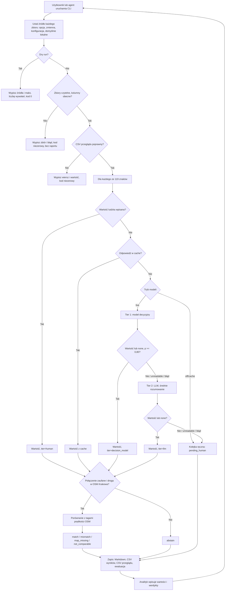

# PRD — Map QA: przegląd znaków ograniczenia prędkości w Krakowie

---

## 1. Podsumowanie

Narzędzie CLI dla analityka map QA. Odczytuje wartość znaków ograniczenia prędkości z wycinków zdjęć ulicznych, porównuje ją z ograniczeniem prędkości OpenStreetMap najbliższej drogi i tworzy raport Markdown oraz kolejkę do ręcznej kontroli. Każdy znak jest odczytywany kaskadą eskalacji: najpierw model decyzyjny, przy jego niepewności zwykły LLM, a gdy żaden nie odpowie, analityk. Dane wejściowe pochodzą z konfigurowalnego źródła: plików lokalnych albo SQL warehouse Databricks. Dokument definiuje MVP (faza 1), który sprawdza przepływ pracy i mierzy na małej próbce z etykietami, jak dobrze modele czytają znaki. Kolejne fazy opisuje sekcja 13.

---

## 2. Problem

Ograniczenia prędkości w danych mapowych często są nieaktualne, brakuje ich albo są przypisane do złej drogi. Dziś analityk ręcznie szuka zdjęcia przy drodze, odczytuje znak i porównuje go z mapą. Nie ma powtarzalnej listy, od czego zacząć, zapisu, dlaczego przypadek pominięto, ani wspólnego zapisu tego, co już przejrzano.

Automatyczny odczyt znaku musi też wiedzieć, kiedy nie odpowiadać. W zestawie znaków z ćwiczenia 30 ze 119 wycinków nie pokazuje czytelnej wartości ograniczenia: są tam znaki strefy, końca strefy, zakazu wjazdu, znaki przekreślone, inne obiekty i jeden nieczytelny znak. Czytnik, który zawsze podaje wartość prędkości, zamieniłby je w fałszywe błędy mapy. Większość zdjęć ulicznych (wszystkie zdjęcia Panoramax) nie ma żadnych detekcji znaków, więc do skalowania poza próbkę Mapillary potrzebny jest czytnik działający na samym obrazie. Maszyna ma rozstrzygać jasne przypadki, przekazywać dalej niejasne, a człowiekowi zostawiać tylko to, co nadal nieznane.

Najbliższa droga nie zawsze jest drogą, której znak dotyczy. W próbce z Krakowa 18 z 31 liczbowych par znak–droga się nie zgadza. Naiwne porównanie „wartości różne → błąd mapy” zgłaszałoby głównie problemy z przypisaniem. Analityk potrzebuje dowodów obok siebie i jawnej informacji o niepewności, a nie werdyktu.

---

## 3. Użytkownicy

**Analityk map QA (główny).** Codziennie pracuje z danymi OSM. Przechodzi kolejkę ręczną: ogląda każdy wycinek, którego modele nie odczytały, i wpisuje wartość. Przegląda każdego kandydata `mismatch` i `map_missing` i zapisuje werdykt: problem potwierdzony, brak problemu albo nie da się ocenić. Mapę edytuje poza tym narzędziem.

**Lider QA (drugorzędny).** Czyta tylko podsumowanie i ewaluację: ile znaków rozstrzygnął każdy tier, ile trafiło do kolejki ręcznej, jak trafne były przyjęte odpowiedzi i ile kosztowały wywołania. Na tej podstawie decyduje, czy rozszerzać kaskadę na kolejne dane i pytania.

**Agent programistyczny obsługujący narzędzie (drugorzędny).** Agent AI (np. Claude Code albo Codex) uruchamia CLI w imieniu analityka. Dostaje w języku naturalnym informację, gdzie są dane i jakiego trybu użyć, i wyraża to wyłącznie przez udokumentowaną konfigurację i opcje, bez zmiany kodu. Nigdy nie widzi wartości poświadczeń, tylko nazwy zmiennych środowiskowych.

---

## 4. Główne przepływy

### 4.1 Wygenerowanie raportu (ścieżka główna)

1. Użytkownik lub agent uruchamia narzędzie z wiersza poleceń. Źródło każdego zbioru danych jest ustalane jak w 4.6 (domyślnie pliki lokalne). Tryb modeli jest wybierany jak w 4.5 (domyślnie `off`).
2. System sprawdza, czy każdy wymagany zbiór jest dostępny w skonfigurowanym źródle i ma wymagane kolumny.
3. System czyta zestaw znaków (zdjęcia, wycinki, najbliższą drogę OSM dla znaku) i drogi OSM, tylko do odczytu. Dla każdego zbioru zapisuje źródło, lokalizację, liczbę wierszy i czas odczytu.
4. Dla każdego znaku system ocenia połączenie znak–droga (4.3). Znak z niezaufanym połączeniem nadal przechodzi przez kaskadę na potrzeby ewaluacji, ale nie jest porównywany z mapą.
5. Dla każdego wycinka system uzyskuje wartość znaku kaskadą eskalacji (4.4).
6. Dla każdego znaku z zaufanym połączeniem i przyjętą wartością system bierze tagi prędkości OSM powiązanej drogi i nadaje jeden wynik: `match`, `mismatch`, `map_missing` albo `not_comparable` (definicje w sekcji 11).
7. System zapisuje raport Markdown, CSV wyników z jednym wierszem na znak oraz CSV przeglądu z kolejką ręczną i kandydatami.
8. Polecenie wypisuje ścieżki wyników, liczności wyników oraz liczbę żądań, trafień cache i koszt na tier, i kończy się kodem 0.

### 4.2 Kolejka ręczna i przegląd kandydatów

1. Analityk otwiera CSV przeglądu i raport Markdown, które linkują do wycinka i pełnego zdjęcia w każdym wierszu.
2. Dla każdego znaku w kolejce analityk wpisuje wartość: liczbę w km/h, `none` albo `unreadable`.
3. Dla każdego kandydata `mismatch` lub `map_missing` analityk zapisuje werdykt (`confirmed`, `no_problem`, `cannot_assess`) i opcjonalny komentarz.
4. Analityk uruchamia narzędzie ponownie. System zachowuje wszystkie wpisane wartości, używa wartości ludzkich do porównania bez wywoływania modeli i pokazuje stan przeglądu w każdym wierszu i w podsumowaniu.

### 4.3 Niezaufane połączenie znak–droga

1. Znak ma flagę połączenia (np. `ambiguous_candidates`, `poor_heading_alignment`, `service_way`, `outside_standard_25m`), jego najbliższej drogi nie ma w zbiorze dróg OSM albo znak leży poza Krakowem.
2. System nie porównuje znaku z mapą. Wynik to `abstain` z przyczyną.
3. Znak nadal przechodzi przez kaskadę (liczy się do ewaluacji modeli) i trafia do sekcji „Nie da się porównać” z przyczyną.

### 4.4 Kaskada eskalacji dla wycinka

1. **Wartość ludzka:** jeśli analityk już wpisał wartość dla znaku, jest ona używana z `tier=human`; żaden model nie jest wywoływany.
2. **Cache:** jeśli jest zapisana odpowiedź dla tego samego obrazu, modelu i wersji pytania, jest używana bez wywołania.
3. **Tier 1 — model decyzyjny:** system wysyła wycinek i neutralne pytanie z zamkniętym zbiorem odpowiedzi (sekcja 11). Model zwraca prawdopodobieństwo każdej odpowiedzi.
   - Najlepsza odpowiedź to wartość lub `none` z prawdopodobieństwem ≥ progu pewności → przyjęta, `tier=decision_model`.
   - Prawdopodobieństwo poniżej progu, najlepsza odpowiedź `unreadable` albo błąd wywołania (`model_unavailable`) → tier 2.
4. **Tier 2 — zwykły multimodalny LLM, średnie rozumowanie:** system wysyła ten sam wycinek i pytanie, bez odpowiedzi tier 1.
   - Odpowiedź to wartość lub `none` z zamkniętego zbioru → przyjęta, `tier=llm`.
   - `unreadable`, odpowiedź spoza zbioru albo błąd wywołania → kolejka ręczna, wynik `pending_human`.
5. **Tier 3 — człowiek:** znak jest w kolejce ręcznej, dopóki analityk nie wpisze wartości.
6. Każda zapisana odpowiedź zawiera tier, identyfikator modelu, odpowiedź, prawdopodobieństwa tier 1 i przyczynę eskalacji na każdym przejściu.

### 4.5 Tryby modeli

1. `off` (domyślny): żaden model nie jest wywoływany. Każdy znak bez wartości ludzkiej trafia do kolejki ręcznej. Pozwala przetestować cały przepływ bez kosztów.
2. `cache`: używane są tylko odpowiedzi z cache. Znaki bez odpowiedzi w cache przechodzą dalej jako `model_unavailable` i kończą w kolejce ręcznej.
3. `live`: tiery są wywoływane w granicach limitów żądań i kosztu. Przed pierwszym płatnym wywołaniem polecenie wypisuje liczbę wycinków do wysłania i limity, a potem prosi o potwierdzenie, chyba że podano opcję potwierdzenia.
4. Opcja próbki ogranicza przebieg do listy identyfikatorów znaków (np. próbki ewaluacyjnej z sekcji 12).

### 4.6 Wybór źródła danych

1. Źródło wybiera się opcją polecenia, zmienną środowiskową albo plikiem konfiguracji, w tej kolejności pierwszeństwa. Bez żadnego z nich źródłem są pliki lokalne.
2. Źródło można ustawić dla wszystkich zbiorów albo osobno dla każdego.
3. Konfiguracja podaje lokalizację każdego zbioru: ścieżkę pliku dla plików lokalnych; katalog, schemat i tabelę oraz identyfikator SQL warehouse dla Databricks.
4. Poświadczenia nigdy nie są zapisywane w pliku konfiguracji. Plik podaje nazwy zmiennych środowiskowych (host, token, warehouse), a system czyta ich wartości w chwili uruchomienia.
5. Przed odczytem system wypisuje ustalone źródło i lokalizację każdego zbioru, bez wartości poświadczeń. Opcja dry-run kończy przebieg w tym miejscu.
6. Wobec Databricks system wykonuje wyłącznie zapytania odczytu.
7. Po odczycie system porównuje liczby wierszy z licznościami snapshotu i przy różnicy wypisuje ostrzeżenie (nie błąd).

### 4.7 Błędy

1. **Brak wejścia lub kolumny:** system zatrzymuje się przed jakimkolwiek wywołaniem modelu, wypisuje zbiór i brakujący plik lub kolumnę, nie zapisuje raportu i kończy się kodem niezerowym.
2. **Databricks niedostępny:** brak zmiennej, błąd uwierzytelnienia, brak uprawnień, nieudane zapytanie albo przekroczenie czasu → przebieg zatrzymuje się przed jakimkolwiek wywołaniem modelu z nazwą zbioru i kategorią błędu, kod niezerowy. Oczekujące zapytanie jest odpytywane po identyfikatorze do limitu czasu i nigdy nie jest wysyłane ponownie. Nie ma cichego przełączenia na pliki lokalne.
3. **Błąd modelu lub wyczerpany budżet:** tier jest pomijany jako `model_unavailable` dla danych znaków, które idą dalej kaskadą. Po osiągnięciu limitu tier nie jest już wywoływany w tym przebiegu. Przebieg kończy się normalnie.
4. **Błędny CSV przeglądu:** werdykt lub wartość ludzka spoza dozwolonego zbioru zatrzymuje przebieg, wypisuje wiersz i wartość i zostawia plik bez zmian.

---

## 5. Historyjki użytkownika

1. Jako analityk map QA chcę listy dróg, na których wartość znaku różni się od ograniczenia OSM albo ograniczenia brakuje, aby najpierw przeglądać prawdopodobne problemy.
2. Jako analityk map QA chcę, aby wycinki, co do których model decyzyjny nie jest pewny, odczytał ponownie zwykły model, zanim trafią do mnie, abym czytał tylko znaki, których maszyny nie odczytały.
3. Jako analityk map QA chcę, aby kolejka ręczna pokazywała odpowiedzi obu modeli i powód każdej eskalacji, abym rozumiał, co w wycinku jest trudne.
4. Jako analityk map QA chcę, aby znaki inne niż ograniczenie prędkości (strefy, końce stref, zakaz wjazdu) dostawały odpowiedź `none`, a nie wartość prędkości, aby nie stały się fałszywymi błędami mapy.
5. Jako analityk map QA chcę, aby wpisane wartości i werdykty przetrwały ponowne uruchomienie, abym nie tracił pracy.
6. Jako lider QA chcę trafności, fałszywych przyjęć, odsetka eskalacji i kosztu na tier na próbce z etykietami, aby zdecydować o rozszerzeniu kaskady.
7. Jako lider QA chcę uruchomić cały przepływ z wyłączonymi modelami, aby zespół mógł go przetestować, zanim wyda pieniądze.
8. Jako agent programistyczny chcę jednego udokumentowanego sposobu wskazania, gdzie jest każdy zbiór i jakiego trybu modeli użyć, abym wykonywał polecenia bez zmiany kodu.
9. Jako opiekun pipeline'u chcę, aby każdy błąd wejścia lub Databricks zatrzymywał przebieg z nazwą zbioru i kategorią błędu, aby raport nigdy nie powstał z niepełnych danych.

---

## 6. Kryteria akceptacji

### Wejścia i bezpieczeństwo

- **AC-01:** Po przebiegu SHA-256 każdego lokalnego pliku wejściowego jest identyczny jak przed przebiegiem.
- **AC-02:** Brak wymaganego pliku lub kolumny zatrzymuje przebieg przed jakimkolwiek wywołaniem modelu, wypisuje zbiór i brakujący element, nie zapisuje raportu i kończy się kodem niezerowym.
- **AC-03:** Dwa przebiegi na identycznych wejściach, z identycznym CSV przeglądu i pełnym cache dają bajtowo identyczne raporty Markdown, z wyjątkiem linii czasu wygenerowania, a drugi przebieg wykonuje zero wywołań modeli.
- **AC-04:** Żadna wartość poświadczeń nie pojawia się w konsoli, logach, raportach, plikach CSV ani w cache.

### Połączenie znak–droga

- **AC-05:** Każdy ze 119 znaków zestawu pojawia się dokładnie raz w CSV wyników, z dokładnie jednym wynikiem.
- **AC-06:** Znak z niepustą flagą połączenia, z najbliższą drogą nieobecną w zbiorze dróg OSM albo z obszarem innym niż Kraków dostaje `abstain` z przyczyną i nie jest porównywany z mapą.
- **AC-07:** Znaki z `abstain` nadal przechodzą przez kaskadę i są uwzględnione w ewaluacji.

### Kaskada eskalacji

- **AC-08:** Odpowiedź tier 1, która jest wartością lub `none` z prawdopodobieństwem ≥ progu pewności, jest przyjęta z `tier=decision_model`, a dla tego znaku nie ma wywołania tier 2.
- **AC-09:** Odpowiedź tier 1 poniżej progu, najlepsza odpowiedź `unreadable` albo błąd tier 1 dają dokładnie jedno wywołanie tier 2.
- **AC-10:** Błąd tier 1 lub tier 2 (błąd HTTP, przekroczenie czasu, wyczerpany budżet) jest zapisywany jako `model_unavailable` z kategorią błędu; nigdy jako `none`, `unreadable` ani wartość.
- **AC-11:** Odpowiedź tier 2 `unreadable`, odpowiedź spoza zamkniętego zbioru albo błąd tier 2 umieszcza znak w kolejce ręcznej jako `pending_human` z przyczyną.
- **AC-12:** Żądanie tier 2 zawiera ten sam wycinek i pytanie co tier 1 i nie zawiera odpowiedzi ani prawdopodobieństw tier 1.
- **AC-13:** Żadne żądanie do modelu nie zawiera wartości mapy, etykiet, wartości detektora Mapillary, nazwy pliku ani identyfikatora zdjęcia; log żądań pokazuje tylko obraz, pytanie i zbiór odpowiedzi.
- **AC-14:** Próg pewności, limit żądań, limit kosztu i timeout każdego tieru są konfigurowalne i wypisywane w nagłówku raportu. W ewaluacji MVP próg wynosi 0,80 i nie zmienia się po pierwszym wywołaniu ewaluacyjnym.
- **AC-15:** Każda próba, także nieudana, liczy się do limitu żądań swojego tieru. Żadne wywołanie nie jest ponawiane automatycznie. Po osiągnięciu limitu tier nie jest już wywoływany w przebiegu, a podsumowanie podaje, który limit osiągnięto i ilu znaków to dotyczyło.
- **AC-16:** Odpowiedź z cache dla tego samego hasha obrazu, identyfikatora modelu i wersji pytania jest używana bez wywołania; podsumowanie podaje trafienia cache na tier.
- **AC-17:** W trybie `off` żaden model nie jest wywoływany, a każdy znak bez wartości ludzkiej ma `pending_human`. W trybie `cache` nie ma żadnego wywołania sieciowego do modelu.
- **AC-18:** W trybie `live` polecenie pokazuje liczbę wycinków i limity i nie wykonuje wywołań przed potwierdzeniem.

### Porównanie z mapą

- **AC-19:** Dla każdego porównanego znaku CSV wyników i raport pokazują wartość znaku i jej tier, identyfikator drogi OSM oraz surowe wartości OSM `maxspeed`, `maxspeed:forward`, `maxspeed:backward` i `maxspeed:conditional`.
- **AC-20:** `match`: wartość znaku i OSM `maxspeed` są liczbami w km/h i są równe, a nie ma żadnego kierunkowego ani warunkowego tagu prędkości.
- **AC-21:** `mismatch`: jak w AC-20, ale wartości są różne.
- **AC-22:** `map_missing`: wartość znaku jest liczbą, a droga nie ma żadnego z czterech tagów prędkości OSM.
- **AC-23:** `not_comparable`: wartość znaku to `none`, albo prędkość OSM nie jest liczbą w km/h (np. `PL:urban`, `none`, `50;70`, `30 mph`), albo jest kierunkowy lub warunkowy tag prędkości. Pokazywane są surowe wartości.
- **AC-24:** Wynik to `pending_human`, dopóki dla znaku nie przyjęto wartości.

### Wyniki i przegląd

- **AC-25:** Każdy przebieg zapisuje jeden raport Markdown, jeden CSV wyników i jeden CSV przeglądu.
- **AC-26:** Raport Markdown zawiera kolejno: nagłówek (źródła, progi, limity, modele, daty, zastrzeżenie), podsumowanie, kandydatów (`mismatch`, `map_missing`), kolejkę ręczną, sekcję „Nie da się porównać” i ewaluację.
- **AC-27:** Każdy wiersz pokazujący wycinek linkuje do wycinka i pełnego zdjęcia ścieżką względną i podaje autora, źródło i licencję.
- **AC-28:** Nagłówek zawiera zdanie „Rozbieżność znaku i mapy nie oznacza automatycznie błędu mapy.”
- **AC-29:** Ponowne uruchomienie zachowuje bez zmian każdą niepustą wartość ludzką, werdykt i komentarz w CSV przeglądu i dodaje wiersze tylko dla nowych pozycji kolejki i kandydatów.
- **AC-30:** Znak z wartością ludzką nigdy nie jest wysyłany do modelu w kolejnych przebiegach.
- **AC-31:** Werdykt spoza `confirmed`, `no_problem`, `cannot_assess` lub pustego, albo wartość ludzka spoza zbioru odpowiedzi, zatrzymuje przebieg z wierszem i wartością i zostawia CSV przeglądu bez zmian.

### Ewaluacja

- **AC-32:** Ewaluacja czyta etykiety znaków wyłącznie na potrzeby ewaluacji; żadna wartość etykiety nie trafia do modelu, kaskady ani porównania.
- **AC-33:** Dla każdego tieru i całej kaskady ewaluacja podaje, z jawnymi mianownikami: znaki wysłane, przyjęte, eskalowane, błędy; trafność przyjętych odpowiedzi na etykietach liczbowych; udział etykiet negatywnych (etykieta nie jest wartością prędkości) z odpowiedzią `none` lub eskalacją; fałszywe przyjęcia (przyjęta odpowiedź różna od etykiety); żądania; koszt; koszt na przyjętą odpowiedź.
- **AC-34:** Etykiety ze statusem `uncertain` i etykieta `unreadable` są wyłączone z mianowników trafności i wykazane osobno z licznością.
- **AC-35:** Ewaluacja pokazuje detektor Mapillary jako bezkosztowy punkt odniesienia z tymi samymi metrykami: klasa `maximum-speed-limit-N` (nie `end-of-…`) daje wartość N; każda inna klasa lub brak klasy daje `none`.
- **AC-36:** Ewaluacja potrafi przeliczyć przyjęcia tier 1 przy innych progach z zapisanych prawdopodobieństw, bez nowych wywołań, i oznacza to jako eksplorację.

### Źródła danych

- **AC-37:** Bez skonfigurowanego źródła narzędzie czyta wszystkie zbiory z plików lokalnych.
- **AC-38:** Opcja polecenia ma pierwszeństwo przed zmienną środowiskową, a ta przed plikiem konfiguracji; nagłówek raportu podaje, co ustaliło źródło każdego zbioru.
- **AC-39:** Przebieg z drogami OSM z Databricks i zestawem znaków z plików lokalnych daje te same wyniki i liczności co przebieg w pełni lokalny.
- **AC-40:** Plik konfiguracji zawierający wartość poświadczenia jest odrzucany z błędem podającym nazwę pola, bez wypisania wartości.
- **AC-41:** Wobec Databricks narzędzie wysyła wyłącznie instrukcje `SELECT` i zapisuje je w logu przebiegu.
- **AC-42:** Brak zmiennej hosta, tokenu lub warehouse zatrzymuje przebieg przed jakimkolwiek zapytaniem i podaje nazwę brakującej zmiennej.
- **AC-43:** Liczba wierszy całego zbioru różna od liczności snapshotu daje ostrzeżenie z obiema liczbami; przebieg trwa dalej.
- **AC-44:** Opcja dry-run wypisuje ustalone źródło i lokalizację każdego zbioru oraz maksymalną liczbę wywołań każdego tieru i kończy się kodem 0, bez odczytu danych i bez wywołania modelu.

---

## 7. Poza zakresem (MVP)

- **Interfejs użytkownika:** brak raportu HTML, dashboardu, widoku mapy i przycisków. Analityk pracuje na raporcie Markdown i plikach CSV. (Faza 2.)
- **Kontrola nawierzchni:** 99 ze 100 etykiet referencyjnych to `paved`, więc nie da się zmierzyć trafności modelu dla nawierzchni. (Faza 2, po oznaczeniu próbki nieutwardzonej.)
- **Statystyki brakujących atrybutów dla wszystkich dróg:** niepotrzebne do sprawdzenia przepływu. (Faza 2.)
- **Ograniczenia prędkości Overture:** ich reguły `when`/`between` wymagają osobnej interpretacji. (Faza 2.)
- **561 zdjęć ulicznych i ich połączenia z drogami:** potrzebne tylko do nawierzchni i innych pytań o zdjęcia. (Faza 2.)
- **Odczyt znaków z pełnych zdjęć:** MVP czyta tylko dostarczone wycinki.
- **Skrzyżowania, oświetlenie, pasy, chodniki, klasa drogi ze zdjęć.** (Kolejne fazy.)
- **`traffic_signs.geojson` jako drugie źródło znaków.** (Kolejne fazy.)
- **Eskalacja przy niezgodności tier 1 i tier 2:** tier 2 nie widzi odpowiedzi tier 1, a jego odpowiedź ze zbioru jest przyjmowana.
- **Porównanie z dodatkowym modelem decyzyjnym:** wymaga osobnego limitu i budżetu dopisanego do PRD.
- **API map i zdjęć na żywo jako wejścia; Databricks przez MCP; zapis do Databricks; inne hurtownie danych.**
- **Edycja mapy; trening modeli; uwierzytelnianie; wielu użytkowników; powiadomienia.**

---

## 8. Ograniczenia

### Biznesowe

- Wszystkie lokalne pliki wejściowe są tylko do odczytu. Wyniki trafiają do `reports/map-qa/`, a cache odpowiedzi do ignorowanego katalogu danych.
- Licencje i atrybucje muszą być zachowane: dane OSM na ODbL 1.0, zdjęcia na CC BY-SA 4.0 z podaniem autora.
- Etykiety znaków przygotowały agenty AI i nie są w pełni zweryfikowane przez człowieka; to robocza referencja, a nie prawda wzorcowa. Każda niezgodność wymaga obejrzenia wycinka przez człowieka.
- Płatne wywołania modeli wymagają limitu żądań i budżetu przyznanego przez prowadzącego przed pierwszym wywołaniem. Klucze API i tokeny Databricks są czytane wyłącznie ze zmiennych środowiskowych i nigdy nie są wypisywane ani logowane.
- Wspólny token Databricks ma zakres `sql`; tryb tylko do odczytu wymusza narzędzie. Zapytania mogą uruchomić współdzielony warehouse; każdy zbiór jest czytany raz na przebieg.

### Funkcjonalne

- Zestaw znaków: 119 zdjęć z wycinkami ze 103 sekwencji; 99 w Krakowie, 20 w innych miastach Polski.
- Tier 1 to model decyzyjny zwracający prawdopodobieństwa dla zamkniętego zbioru odpowiedzi. Tier 2 to zwykły multimodalny LLM ze średnim rozumowaniem. Konkretne modele wybiera ADR.
- Limity żądań MVP: tier 1 najwyżej 25, tier 2 najwyżej 10, oba wliczając błędy; mniej, jeśli przydział prowadzącego jest mniejszy. Timeout 40 s na żądanie.
- Język raportu: polski dla nagłówków i etykiet; identyfikatory, klucze tagów i surowe wartości bez zmian.
- Bez dostępu do sieci tryby `off` i `cache` kończą się na danych lokalnych.

### Zewnętrzne dane

Pliki lokalne są w `course-materials/exercise-data/map-qa/`. Tabele Databricks są w `workspace.map_qa`.

| Dane | Plik lokalny | Tabela Databricks | Kiedy używane |
|---|---|---|---|
| Zdjęcia znaków | `signs/signs.csv`, `signs/photos/` | — (tylko lokalnie) | Pozycja znaku, obszar, sekwencja, autor, licencja, wartość detektora (tylko punkt odniesienia) |
| Wycinki znaków | `signs/crops/` | — (tylko lokalnie) | Obraz wysyłany do modeli; pokazywany analitykowi |
| Najbliższa droga OSM | `signs/nearest_osm.csv` | — (tylko lokalnie) | Połączenie znak–droga i flagi |
| Drogi OSM | `osm_roads.parquet` | `osm_roads` | Tagi prędkości powiązanej drogi |
| Etykiety znaków | `signs/labels.csv` | — (tylko lokalnie) | Wyłącznie ewaluacja |
| Metadane źródeł | `sources.json` | — (tylko lokalnie) | Daty snapshotu i liczności |

---

## 9. Opis interfejsu

MVP nie ma interfejsu graficznego.

### 9.1 Wiersz poleceń

- Opcje: źródło danych (wszystkie zbiory lub osobno), plik konfiguracji, katalog wyników, tryb modeli (`off`, `cache`, `live`), próbka (lista identyfikatorów lub plik), próg pewności, limity żądań i kosztu na tier, ścieżka CSV przeglądu, potwierdzenie, dry-run.
- Przykładowy plik konfiguracji podaje dla każdego zbioru lokalizację lokalną i w Databricks oraz tylko nazwy zmiennych z poświadczeniami.
- Po sukcesie: ścieżki wyników, tabela wyników i tabela tierów (wysłane, przyjęte, eskalowane, błędy, trafienia cache, żądania, koszt).
- Po błędzie: jedna linia z nazwą zbioru, pliku, kolumny, zmiennej albo wiersza przeglądu; kod niezerowy.

### 9.2 Raport Markdown

- **Nagłówek:** czas wygenerowania, źródło każdego zbioru i sposób jego wyboru, data snapshotu OSM, tryb modeli, identyfikatory modeli, próg, limity, timeout, zastrzeżenie (AC-28).
- **Podsumowanie:** liczności wyników; wielkość kolejki ręcznej; liczba przejrzanych i potwierdzonych.
- **Kandydaci:** wiersz na każdy `mismatch` / `map_missing`: identyfikator znaku, link do wycinka, wartość znaku i tier, identyfikator drogi OSM, surowe tagi prędkości, dystans, stan przeglądu.
- **Kolejka ręczna:** identyfikator znaku, link do wycinka, najlepsza odpowiedź i prawdopodobieństwo tier 1, odpowiedź tier 2, przyczyny eskalacji, wartość ludzka.
- **Nie da się porównać:** identyfikator znaku, przyczyna.
- **Ewaluacja:** tabele zgodnie z AC-33 do AC-36.
- Puste sekcje pokazują „0 pozycji”.

### 9.3 CSV przeglądu

- Kolumny: identyfikator wiersza, typ wiersza (`queue` lub `candidate`), identyfikator znaku, identyfikator drogi OSM, odpowiedź tier 1, odpowiedź tier 2, wartość ludzka (pusta), wynik, werdykt (pusty), komentarz (pusty).

---

## 10. Diagram przepływu

---

## 11. Zachowanie systemu i modeli

### Pytanie

Jedno pytanie na wycinek, po angielsku, neutralne, z zamkniętym zbiorem odpowiedzi:

- wartość prędkości w km/h z okrągłego znaku zakazu z czerwonym obrzeżem (B-33), jedna z 5–140 co 5 lub co 10;
- `none` — wycinek nie pokazuje znaku B-33 (znak strefy, koniec strefy, koniec ograniczenia, inny znak, brak znaku);
- `unreadable` — znak B-33 jest widoczny, ale jego wartości nie da się odczytać.

### Tiery

| Tier | Kto | Przyjmuje | Eskaluje |
|---|---|---|---|
| 1 | Model decyzyjny | Wartość lub `none` z p ≥ 0,80 | p < 0,80, `unreadable`, `model_unavailable` |
| 2 | Zwykły multimodalny LLM, średnie rozumowanie | Wartość lub `none` | `unreadable`, odpowiedź spoza zbioru, `model_unavailable` |
| 3 | Analityk | Wartość wpisana w CSV przeglądu | — (do tego czasu `pending_human`) |

### Wyniki

| Wynik | Znaczenie |
|---|---|
| `match` | Wartość znaku równa jedynemu liczbowemu OSM `maxspeed`. |
| `mismatch` | Wartość znaku różna od jedynego liczbowego OSM `maxspeed`. Kandydat. |
| `map_missing` | Wartość znaku liczbowa; droga nie ma tagu prędkości OSM. Kandydat. |
| `not_comparable` | Znak `none`, prędkość OSM niebędąca liczbą w km/h albo kierunkowe/warunkowe tagi prędkości. |
| `abstain` | Połączenie znak–droga niezaufane, drogi nie ma w zbiorze albo znak poza Krakowem. |
| `pending_human` | Brak przyjętej wartości; znak w kolejce ręcznej. |

`unreadable` to odpowiedź modelu; `model_unavailable` to błąd wywołania. Żadne z nich nie jest zamieniane na wartość ani na `none`.

### Zabronione

- Stwierdzanie błędu mapy: problem oznacza wyłącznie werdykt analityka `confirmed`.
- Wysyłanie do modelu wartości mapy, etykiet, wartości detektora, nazw plików albo odpowiedzi innego tieru.
- Automatyczne ponawianie wywołań albo przekraczanie limitów tieru.
- Traktowanie pozycji aparatu jako pozycji znaku albo najbliższej drogi jako dowodu, że znak jej dotyczy.
- Zmiana plików wejściowych albo nadpisywanie wartości wpisanych przez analityka.

---

## 12. Plan walidacji MVP i ewaluacji modeli

### Dlaczego tylko znaki ograniczenia prędkości

| Pytanie | Dostępne etykiety | Nadaje się do MVP |
|---|---|---|
| Wartość znaku ograniczenia (wycinki) | 119 wycinków: 89 wartości liczbowych (20–120 km/h, 6–9 na wartość), 29 negatywnych, 1 nieczytelny; 4 uncertain | Tak — zrównoważone wartości i prawdziwe przypadki negatywne |
| Nawierzchnia | 100 zdjęć: 99 `paved`, 1 `unknown`, 0 `unpaved` | Nie — nie da się zmierzyć błędu dla nawierzchni nieutwardzonej |
| Skrzyżowanie, oświetlenie | 100 zdjęć | Brak zdefiniowanego porównania z mapą |

### Etapy

| Etap | Tryb | Znaki | Płatne wywołania | Co sprawdza |
|---|---|---|---|---|
| 0. Przepływ | `off`, pliki lokalne; potem `off` z drogami OSM z Databricks | wszystkie 119 | 0 | Odczyt, połączenia, porównanie, wyniki, runda przeglądu, zmiana źródła (AC-39) |
| 1. Smoke | `live` | 5 stałych: 3 liczbowe o różnych wartościach, 1 znak strefy, 1 przekreślony znak ograniczenia | ≤ 5 tier 1, ≤ 5 tier 2 | Prawdziwy kształt żądań i odpowiedzi, cache, zapis kosztu, obsługa błędów |
| 2. Ewaluacja | `live` | 20 kolejnych, warstwowo: 13 liczbowych, każda wartość jeszcze nieobecna co najmniej raz; 6 negatywnych: drugi przekreślony znak, fałszywie wykryty obiekt z klasą prędkości, koniec strefy, zakaz wjazdu, ograniczenie masy, brak znaku prędkości; 1 znak nieczytelny; najwyżej jeden znak na sekwencję; bez etykiet uncertain | ≤ 20 tier 1, reszta budżetu tier 2 | Jakość modeli na tier wobec punktu odniesienia detektora |
| 3. Powtórka | `cache` | te same 25 | 0 | Powtarzalność AC-03; eksploracja progów (AC-36) |

Pozostałe 94 znaki są odłożone na kolejne fazy, aby przyszłą zmianę progu sprawdzić na niewidzianych znakach.

### Czego oczekujemy i cele MVP

Punkt odniesienia z detektora Mapillary (AC-35) jest na tym zestawie mocny: zgadza się ze wszystkimi 89 etykietami liczbowymi i daje `none` dla 26 z 30 pozostałych wycinków. Myli się w 4 przypadkach: 2 przekreślonych znakach, 1 fałszywie wykrytym obiekcie i 1 nieczytelnym znaku, wszystkie z klasą ograniczenia prędkości. Próbka zawiera więc wszystkie 4 trudne przypadki.

Konsekwencje dla MVP:

- Na wycinkach kaskada może co najwyżej usunąć 4 błędy detektora; nie pokaże dużego zysku. Ewaluacja MVP sprawdza, że kaskada **nie jest gorsza** od detektora i że eskalacja oraz kolejka ręczna działają.
- Prawdziwa wartość kaskady jest na zdjęciach **bez** detekcji (wszystkie 461 zdjęć Panoramax), gdzie nie ma punktu odniesienia. To powód jej budowy i cel fazy 2.

Cele ustalone przed etapem 1:

- Fałszywe przyjęcia w kaskadzie (przyjęta odpowiedź ≠ etykieta): najwyżej 1 na 24 ocenianych znaki z pewną, czytelną etykietą.
- Trudne przypadki (2 przekreślone znaki, 1 fałszywy obiekt): co najmniej 2 z 3 z odpowiedzią `none` albo eskalowane, a nie przyjęte jako wartość prędkości.
- Znak nieczytelny trafia do kolejki ręcznej, a nie zostaje przyjęty jako wartość.
- Kolejka ręczna: najwyżej 10 z 25 znaków (40%).
- Każde płatne żądanie, błąd i koszt są w logu; powtórka w etapie 3 wykonuje zero wywołań.

Przy 25 znakach to sygnały „dalej / stop” dla przepływu, a nie oszacowanie trafności. Niespełniony cel jest raportowany, a nie ukrywany, i prowadzi do zmiany pytania, progu albo modelu w nowej ewaluacji na znakach odłożonych.

### Oczekiwane wyniki porównania dla Krakowa (z etykiet, przed uruchomieniem modeli)

Z 99 znaków w Krakowie 74 ma etykietę liczbową. Przy zaufanym połączeniu i drodze obecnej w pliku dróg OSM reguły AC-20 do AC-23 dają: 13 `match`, 18 `mismatch`, 7 `map_missing`, 7 `not_comparable` (kierunkowe lub warunkowe tagi prędkości). Wysoki udział `mismatch` wynika prawdopodobnie głównie z przypisania znaków do niewłaściwej, pobliskiej drogi. Dlatego każdy kandydat wymaga werdyktu analityka.

---

## 13. Kolejne fazy

- **Faza 2:** raport HTML z miniaturami albo prosty interfejs przeglądu; reguły prędkości Overture z `when`/`between`; statystyki brakujących atrybutów dla wszystkich dróg; 561 zdjęć ulicznych i ich połączenia z drogami; kontrola nawierzchni po oznaczeniu próbki nieutwardzonej.
- **Faza 3:** kolejne pytania o zdjęcia (skrzyżowania, oświetlenie, pasy); znaki z pełnych zdjęć; `traffic_signs.geojson`; eskalacja przy niezgodności tierów; inne źródła danych.

---

## 14. Dodatkowe uwagi

- **Próg pewności 0,80:** wartość startowa ustalona przed pomiarem. Nie wolno jej dostrajać na ocenianych znakach i raportować wyniku jako trafności; eksploracja progów w etapie 3 jest oznaczona jako eksploracyjna i sprawdzana później na znakach odłożonych.
- **Pewność tier 2:** zwykły LLM nie zwraca skalibrowanych prawdopodobieństw; w MVP jego odpowiedź ze zbioru jest przyjmowana.
- **Znaki spoza Krakowa (20):** tylko do ewaluacji modeli; zbiór dróg OSM obejmuje Kraków.
- **Dystans znak–droga:** mediana 3,4 m, maksimum 103 m. Flagi połączeń z `signs/nearest_osm.csv` są używane bez zmian.
- **Dostęp do Databricks:** wybór między REST API a CLI należy do ADR. Managed MCP zwraca HTTP 403 dla wspólnego tokenu z zakresem `sql`.
- **Pytanie otwarte:** czy volume Databricks `/Volumes/workspace/map_qa/inputs/` zawiera zestaw znaków i czy w kolejnej fazie ma być jego źródłem.
