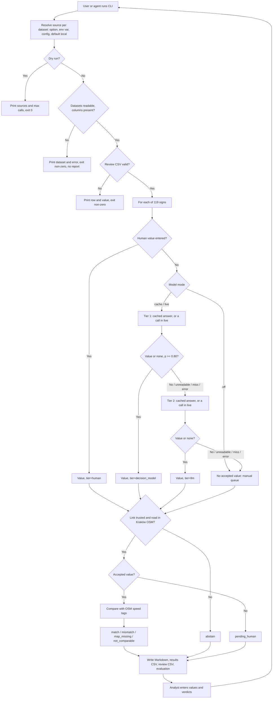

# PRD — Map QA: Speed-Limit Sign Review for Kraków

---

## 1. Executive Summary

A command-line tool for a map QA analyst that reads the value of speed-limit signs from street-photo crops, compares it with the OpenStreetMap speed limit of the nearest road, and produces a Markdown report and a review queue for manual checking. Each sign is read through an escalation chain: a decision model first, a general-purpose LLM when the decision model is uncertain, and the analyst when neither can answer. Input data come from a configurable source (local files or a Databricks SQL warehouse). This document defines the MVP (phase 1), which proves the workflow and measures how well the models read signs on a small labelled sample; later phases are listed in section 13.

---

## 2. Problem Statement

Speed limits in map data are often missing, outdated or attached to the wrong road. Today an analyst finds a street photo near a road, reads the sign, and compares it with the map by hand. There is no repeatable list of where to look first, no record of why a case was skipped, and no shared record of what was already reviewed.

Automatic sign reading must also know when not to answer. In the exercise sign set, 30 of 119 crops do not show a readable speed-limit value (zone signs, zone ends, no-entry, cancelled signs, other objects, one unreadable sign). An automatic reader that always gives a speed value would turn these into false map errors. Most street photos (all Panoramax photos) have no sign detections at all, so a reader that works from the image alone is needed to scale beyond the Mapillary sample. The analyst needs the machine to answer the clear cases, pass the unclear ones on, and send to a human only what remains unknown.

The nearest road to a sign is also not always the road the sign applies to. In the Kraków sample, 18 of the 31 numeric sign–road pairs disagree. A naive "values differ → map error" comparison would mostly report assignment problems. The analyst needs evidence side by side and an explicit statement of uncertainty, not a verdict.

---

## 3. Users / Personas

**Map QA analyst (primary).** Works with OSM data daily. Works through the manual queue: looks at each sign crop that the models could not read and enters the value. Reviews every `mismatch` and `map_missing` candidate and records a verdict: problem confirmed, no problem, or cannot assess. Edits the map outside this tool.

**QA lead (secondary).** Reads the summary and evaluation sections only: how many signs each tier answered, how many reached the manual queue, how accurate the accepted answers were, what the calls cost. Uses it to decide whether the chain is worth extending to more data and questions.

**Coding agent operating the tool (secondary).** An AI agent (for example Claude Code or Codex) runs the CLI on the analyst's behalf. It is told in natural language where the data are and which mode to run, and expresses that only through the documented configuration and options, without editing code. It never sees credential values, only the names of environment variables.

---

## 4. Main Flows

### 4.1 Generate the report (happy path)

1. The user or agent runs the tool from the command line. The data source for each dataset is resolved as described in 4.6 (default: local files). The model mode is chosen as described in 4.5 (default: `off`).
2. The system validates that every required dataset is reachable in its configured source and has the required columns.
3. The system reads the sign set (sign photos, crops, nearest OSM road per sign) and the OSM roads, read-only, and records for each dataset its source, location, row count and read time.
4. For each sign, the system evaluates the sign-to-road link (4.3). An untrusted link is still read by the chain for evaluation, but it is not compared with the map.
5. For each sign crop, the system obtains the sign value through the escalation chain (4.4).
6. For each sign with a trusted link and an accepted value, the system takes the OSM speed tags of the linked road and assigns one outcome: `match`, `mismatch`, `map_missing`, `not_comparable` (definitions in section 11).
7. The system writes a Markdown report, a results CSV with one row per sign, and a review CSV with the manual queue and the candidates.
8. The command prints the output paths, outcome counts, and requests, cache hits and cost per tier, and exits with code 0.

### 4.2 Work through the manual queue and review candidates

1. The analyst opens the review CSV and the Markdown report, which link to the crop and full photo for each row.
2. For each queued sign, the analyst enters the sign value (a number in km/h, `none` or `unreadable`).
3. For each `mismatch` or `map_missing` candidate, the analyst records a verdict (`confirmed`, `no_problem`, `cannot_assess`) and an optional comment.
4. The analyst re-runs the tool. The system keeps all entered values, uses human values for the comparison without calling any model, and shows the review status per row and in the summary.

### 4.3 Untrusted sign-to-road link

1. A sign has a link flag (for example `ambiguous_candidates`, `poor_heading_alignment`, `service_way`, `outside_standard_25m`), its nearest road is not found in the OSM roads dataset, or the sign is outside the Kraków area.
2. The system does not compare the sign with the map. The outcome is `abstain` with the reason.
3. The sign is still read by the chain (it counts for model evaluation) and is listed in the "Cannot compare" section with its reason.

### 4.4 Escalation chain for reading a sign crop

1. **Human value:** if the analyst already entered a value for this sign, it is used with `tier=human`; no model is called.
2. **Cache (modes `cache` and `live` only):** before each tier, if an answer from that tier's model for the same image and question version is cached, it is used instead of a call and passes the same tier rule.
3. **Tier 1 — decision model:** the system sends the crop and a neutral question with a closed answer set (section 11). The model returns a probability for each answer.
   - Top answer is a value or `none` with probability ≥ the confidence threshold → accepted, `tier=decision_model`.
   - Probability below the threshold, top answer `unreadable`, or call failure (`model_unavailable`) → tier 2.
4. **Tier 2 — general-purpose multimodal LLM, medium reasoning:** the system sends the same crop and question, without the tier-1 answer.
   - Answer is a value or `none` from the closed set → accepted, `tier=llm`.
   - `unreadable`, answer outside the set, or call failure → manual queue, outcome `pending_human`.
5. **Tier 3 — human:** the sign appears in the manual queue until the analyst enters a value.
6. Every stored answer records the tier, model identifier, answer, tier-1 probabilities, and the escalation reason for each tier passed.

### 4.5 Model modes

1. `off` (default): no model is called and the answer cache is not read. Every sign without a human value goes to the manual queue. This tests the whole workflow at zero cost.
2. `cache`: only cached answers are used, checked per tier, and a cached answer passes the same tier rule as a fresh one. A tier without a cached answer counts as `model_unavailable`, and the sign goes down the chain and ends in the manual queue.
3. `live`: tiers are called within their request and cost limits. Before the first paid call, the command prints the number of crops to send and the limits, and asks for confirmation unless a confirmation option is given.
4. A sample option restricts the run to a listed set of sign ids (for example the evaluation sample in section 12).

### 4.6 Choose the data source

1. The source is selected by command option, environment variable or configuration file, in that order of precedence. With none given, the source is local files.
2. The source can be set for all datasets or per dataset.
3. The configuration names each dataset's location: a file path for local files; catalog, schema and table for Databricks, plus the SQL warehouse identifier.
4. Credentials are never written in the configuration file. It names environment variables (host, token, warehouse), and the system reads their values at run time.
5. Before reading, the system prints the resolved source and location of every dataset, without credential values. A dry-run option stops here.
6. The system runs only read queries against Databricks.
7. After reading, the system compares row counts with the snapshot counts and prints a warning (not an error) when they differ.

### 4.7 Errors

1. **Missing input or column:** the system stops before any model call, prints the dataset and missing file or column, writes no report, and exits non-zero.
2. **Databricks unavailable:** missing variable, authentication error, permission error, failed query or timeout → the run stops before any model call with the dataset and error category, and exits non-zero. A pending query is polled by its identifier until the timeout and never resubmitted. There is no silent fallback to local files.
3. **Model failure or budget exhausted:** the failing tier is skipped as `model_unavailable` for the affected signs, which continue down the chain. When a tier's limit is reached, it is not called again in the run. The run completes.
4. **Invalid review CSV:** a verdict or human value outside its allowed set stops the run, prints the row and value, and leaves the file unchanged.
5. **Missing model key:** in mode `live`, a missing `OPENROUTER_API_KEY` is a configuration error, not a model failure. It is checked before the confirmation prompt, stops the run with the variable name and exits non-zero. Failures during calls follow item 3.

---

## 5. User Stories

1. As a map QA analyst, I want a list of roads where the sign value differs from the OSM speed limit or the speed limit is missing, so that I can review the likely problems first.
2. As a map QA analyst, I want crops that the decision model is unsure about to be re-read by a general-purpose model before they reach me, so that I only read the signs that machines could not.
3. As a map QA analyst, I want the manual queue to show both model answers and why each escalated, so that I understand what is hard about the crop.
4. As a map QA analyst, I want non-speed signs (zones, zone ends, no-entry) to be answered as `none` rather than as a speed value, so that they do not become false map errors.
5. As a map QA analyst, I want my entered values and verdicts to survive a re-run, so that I do not lose review work.
6. As a QA lead, I want accuracy, false acceptances, escalation rate and cost per tier on a labelled sample, so that I can decide whether to extend the chain.
7. As a QA lead, I want the whole workflow to run with models switched off, so that the team can test it before any money is spent.
8. As a coding agent, I want one documented way to set where each dataset lives and which model mode to use, so that I can follow instructions without changing code.
9. As a pipeline maintainer, I want any input or Databricks failure to stop the run with the dataset name and error category, so that a report is never built from partial data.

---

## 6. Acceptance Criteria

### Inputs and safety

- **AC-01:** After a run, the SHA-256 hash of every local input file is identical to the hash before the run.
- **AC-02:** A missing required file or column stops the run before any model call, prints the dataset and the missing item, writes no report, and exits non-zero.
- **AC-03:** Two runs on identical inputs, an identical review CSV and a complete cache produce byte-identical Markdown reports, except for the generation timestamp line, and the second run makes zero model calls.
- **AC-04:** No credential value appears in console output, logs, reports, CSV files or the cache.

### Sign-to-road link

- **AC-05:** Every one of the 119 signs in the sign set appears exactly once in the results CSV, with exactly one outcome.
- **AC-06:** A sign with a non-empty link flag, a nearest road that is not found in the OSM roads dataset, or an area other than Kraków gets `abstain` with the reason and is not compared with the map.
- **AC-07:** Abstained signs are still read by the chain and included in the evaluation section.

### Escalation chain

- **AC-08:** A tier-1 answer that is a value or `none` with probability ≥ the confidence threshold is accepted with `tier=decision_model`, and no tier-2 call is made for that sign.
- **AC-09:** A tier-1 answer below the threshold, a top answer of `unreadable`, or a tier-1 failure results in exactly one tier-2 call.
- **AC-10:** A tier-1 or tier-2 failure (HTTP error, timeout, budget exhausted) is recorded as `model_unavailable` with the error category; it is never recorded as `none`, `unreadable` or a value.
- **AC-11:** A tier-2 answer of `unreadable`, an answer outside the closed set, or a tier-2 failure puts the sign in the manual queue as `pending_human` with the reason.
- **AC-12:** The tier-2 request contains the same crop and question as tier 1 and does not contain the tier-1 answer or probabilities.
- **AC-13:** No model request contains map values, labels, the Mapillary detector value, the file name or the photo id; the request log shows only the image, the question and the answer set.
- **AC-14:** The confidence threshold, request limit, cost limit and timeout of each tier are configurable and printed in the report header. In the MVP evaluation, the threshold is 0.80 and is not changed after the first evaluation call.
- **AC-15:** Every attempt, including failed ones, counts against its tier's request limit. No call is retried automatically. When a limit is reached, the tier is not called again in the run, and the summary states which limit was reached and how many signs were affected.
- **AC-16:** A cached answer for the same image hash, model identifier and question version is reused without a call; the summary shows cache hits per tier.
- **AC-17:** In mode `off`, no model is called, the cache is not read, and every sign with a trusted link and without a human value is `pending_human`. In mode `cache`, no network call to a model is made.
- **AC-18:** In mode `live`, the command shows the number of crops and the limits and makes no call until confirmed.

### Comparison with the map

- **AC-19:** For each compared sign, the results CSV and report show the sign value and its tier, the OSM way id, and the raw OSM `maxspeed`, `maxspeed:forward`, `maxspeed:backward` and `maxspeed:conditional` values, plus the raw implicit-limit tag (AC-23) when one is present.
- **AC-20:** `match`: the sign value and the OSM `maxspeed` are both numeric in km/h and equal, and no directional or conditional speed tag is present.
- **AC-21:** `mismatch`: as AC-20, but the values differ.
- **AC-22:** `map_missing`: the sign value is numeric, the road has none of the four OSM speed tags and no implicit-limit tag (AC-23).
- **AC-23:** `not_comparable`: the sign value is `none`, or the OSM speed is not a number in km/h (for example `PL:urban`, `none`, `50;70`, `30 mph`), or a directional or conditional speed tag is present, or the road has none of the four speed tags but has an implicit-limit tag: `maxspeed:type`, `source:maxspeed` or `zone:maxspeed` with a country-code value such as `PL:urban`, `PL:rural` or `PL:zone30`. The statutory limit is not derived, and a conditional tag is not evaluated against the photo time. The raw values are shown.
- **AC-24:** The outcome is `pending_human` while the sign-to-road link is trusted and no value has been accepted for the sign. `abstain` (AC-06) takes precedence: an abstained sign keeps `abstain` whether or not it has a value.

### Outputs and review

- **AC-25:** Each run writes one Markdown report, one results CSV and one review CSV.
- **AC-26:** The Markdown report contains, in order: header (sources, thresholds, limits, models, dates, disclaimer), summary, candidates (`mismatch`, `map_missing`), manual queue, cannot compare, evaluation.
- **AC-27:** Every row that shows a crop links to the crop and full photo by relative path and shows the author, source and licence.
- **AC-28:** The header contains the sentence "Rozbieżność znaku i mapy nie oznacza automatycznie błędu mapy."
- **AC-29:** Re-running keeps every non-empty human value, verdict and comment in the review CSV unchanged, and adds rows only for new queue items and candidates.
- **AC-30:** A sign with a human value is never sent to a model in later runs.
- **AC-31:** A verdict outside `confirmed`, `no_problem`, `cannot_assess` or empty, or a human value outside the answer set, stops the run with the row and value, and leaves the review CSV unchanged.

### Evaluation

- **AC-32:** The evaluation section reads the sign labels only for evaluation; no label value reaches a model, the chain or the comparison.
- **AC-33:** For each tier and for the chain as a whole, the evaluation reports, with explicit denominators: signs sent, accepted, escalated, failed; accuracy of accepted answers on numeric labels; share of negative labels (label not a speed value) answered `none` or escalated; false acceptances (an accepted answer that differs from the label); requests; cost; cost per accepted answer.
- **AC-34:** Labels with status `uncertain` and the label `unreadable` are excluded from accuracy denominators and listed separately with their count.
- **AC-35:** The evaluation shows the Mapillary detector as a zero-cost baseline with the same metrics: a class `maximum-speed-limit-N` (not `end-of-…`) maps to value N; every other class or an empty class maps to `none`.
- **AC-36:** The evaluation can recompute tier-1 acceptance at other thresholds from stored probabilities without new calls, and labels this as exploratory.

### Data sources

- **AC-37:** With no source configured, the tool reads all datasets from local files.
- **AC-38:** Command option overrides environment variable, which overrides the configuration file; the report header states which one set each dataset's source.
- **AC-39:** A run with OSM roads from Databricks and the sign set from local files produces the same outcomes and counts as a run with all datasets local.
- **AC-40:** A configuration file containing a credential value is rejected with an error naming the field, without printing the value.
- **AC-41:** Against Databricks, the tool submits only `SELECT` statements and writes them to the run log.
- **AC-42:** A missing host, token or warehouse variable stops the run before any query, naming the missing variable.
- **AC-43:** For each dataset with a snapshot row count in `sources.json` (in the MVP: `osm_roads`), a row count that differs from it shows a warning with both numbers; the run continues.
- **AC-44:** The dry-run option prints the resolved source and location of each dataset and the number of model calls each tier would make at most, and exits with code 0 without reading data or calling a model.

---

## 7. Out of Scope (MVP)

- **User interface:** no HTML report, dashboard, map view or buttons. The analyst works in the Markdown report and CSV files. (Phase 2.)
- **Surface check:** 99 of 100 reference surface labels are `paved`, so model accuracy on surface cannot be measured. (Phase 2, after an unpaved sample is labelled.)
- **Missing-attribute statistics for all roads:** not needed to prove the workflow. (Phase 2.)
- **Overture speed limits:** their `when`/`between` rules need separate interpretation. (Phase 2.)
- **The 561 street photos and their road links:** used only by the surface and other photo questions. (Phase 2.)
- **Reading signs from full photos:** the MVP reads the provided crops only.
- **Junction, lighting, lanes, sidewalk, road class from photos.** (Later phases.)
- **`traffic_signs.geojson` as a second sign source.** (Later phases.)
- **Escalating on disagreement between tier 1 and tier 2:** tier 2 is not shown tier 1's answer, and its in-set answer is accepted.
- **Live map and photo APIs as inputs; Databricks through MCP; writing to Databricks; other warehouses.**
- **Editing the map; model training; authentication; multiple users; notifications.**

---

## 8. Constraints

### Business

- All local input files are read-only. Run outputs go to `reports/map-qa/run/`, which is ignored by Git, so the analyst's `review.csv` is not versioned and must be kept or backed up by the analyst. The answer cache goes to an ignored data directory. Committed analysis such as `reports/map-qa/profile.md` stays in `reports/map-qa/`.
- Licences and attribution must be preserved: OSM data under ODbL 1.0, photos under CC BY-SA 4.0 with author credit.
- The sign labels were produced by AI agents and are not fully human-verified; they are a working reference, not ground truth. Each disagreement needs a human look at the crop.
- Paid model calls need a request and cost budget allocated before the first call. Granted on 2026-11-12: Jev 1.14, Luna Decisions and GPT-6 Luna may be used for development captures, E2E and manual tests, with a total cost under 1 USD. The per-tier limits below still apply to each evaluation experiment. API keys and Databricks tokens are read only from environment variables and are never printed or logged.
- The shared Databricks token has the `sql` scope; read-only behaviour is enforced by the tool. Queries can start a shared warehouse; each dataset is read once per run (for a Databricks dataset: one row-count query and one projected read).

### Functional

- Sign set: 119 sign photos with crops from 103 sequences; 99 in Kraków, 20 in other Polish cities.
- Tier 1 is a decision model returning probabilities over a closed answer set. Tier 2 is a general-purpose multimodal LLM used at medium reasoning. Concrete models are chosen in the ADR.
- MVP request limits: tier 1 at most 25 requests, tier 2 at most 10 requests, both including failures; lower if the trainer's allocation is lower. Timeout 40 s per request.
- Report language: Polish for headings and labels; identifiers, tag keys and raw values unchanged.
- Without network access, modes `off` and `cache` complete on local data.

### External data references

Local files are in `course-materials/exercise-data/map-qa/`. Databricks tables are in `workspace.map_qa`.

| Data | Local file | Databricks table | When used |
|---|---|---|---|
| Sign photos | `signs/signs.csv`, `signs/photos/` | — (local only) | Sign position, area, sequence, author, licence, detector value (baseline only) |
| Sign crops | `signs/crops/` | — (local only) | Image sent to the models; shown to the analyst |
| Nearest OSM road per sign | `signs/nearest_osm.csv` | — (local only) | Sign-to-road link and flags |
| OSM roads | `osm_roads.parquet` | `osm_roads` | OSM speed tags of the linked road |
| Sign labels | `signs/labels.csv` | — (local only) | Evaluation only |
| Source metadata | `sources.json` | — (local only) | Snapshot dates and row counts |

---

## 9. UI Description

The MVP has no graphical interface.

### 9.1 Command line

- Options: data source (all datasets or per dataset), configuration file, output directory, model mode (`off`, `cache`, `live`), sample (list of sign ids or a file), confidence threshold, per-tier request and cost limits, review CSV path, confirmation, dry-run.
- An example configuration file lists every dataset with a local and a Databricks location and only the names of credential variables.
- On success: output paths, an outcome table and a tier table (sent, accepted, escalated, failed, cache hits, requests, cost).
- On failure: one error line naming the dataset, file, column, variable or review row; non-zero exit code.

### 9.2 Markdown report

- **Header:** generation time, data sources per dataset and how each was chosen, OSM snapshot date, model mode, model identifiers, threshold, limits, timeout, disclaimer (AC-28).
- **Summary:** outcome counts; manual queue size; reviewed and confirmed counts.
- **Candidates:** one row per `mismatch` / `map_missing`: sign id, crop link, sign value and tier, OSM way id, raw speed tags, distance, review status.
- **Manual queue:** sign id, crop link, tier-1 top answer and probability, tier-2 answer, escalation reasons, human value.
- **Cannot compare:** sign id, reason.
- **Evaluation:** tables per AC-33 to AC-36.
- Empty sections show "0 pozycji".

### 9.3 Review CSV

- Columns: row id, row type (`queue` or `candidate`), sign id, OSM way id, tier-1 answer, tier-2 answer, human value (empty), outcome, verdict (empty), comment (empty).
- `queue` rows cover every sign without an accepted value, including abstained signs (outcome `abstain`): their value still counts for evaluation (AC-07), but they are not compared with the map.

---

## 10. User Flow Diagram

---

## 11. Agent / System Behavior Specification

### Question

One question per crop, in English, neutral, with the closed answer set:

- a speed value in km/h from a round prohibition sign with a red border (B-33), one of 5–140 in steps of 5 or 10;
- `none` — the crop does not show a B-33 speed-limit sign (zone sign, zone end, end of limit, other sign, not a sign);
- `unreadable` — a B-33 sign is present but its value cannot be read.

### Tiers

| Tier | Who | Accepts | Escalates |
|---|---|---|---|
| 1 | Decision model | Value or `none` with p ≥ 0.80 | p < 0.80, `unreadable`, `model_unavailable` |
| 2 | General-purpose multimodal LLM, medium reasoning | Value or `none` | `unreadable`, out-of-set answer, `model_unavailable` |
| 3 | Analyst | Value entered in the review CSV | — (until then `pending_human`) |

### Outcomes

| Outcome | Meaning |
|---|---|
| `match` | Sign value equals the single numeric OSM `maxspeed`. |
| `mismatch` | Sign value and single numeric OSM `maxspeed` differ. Candidate. |
| `map_missing` | Sign value numeric; road has no OSM speed tag and no implicit-limit tag. Candidate. |
| `not_comparable` | Sign `none`, OSM speed that is not a number in km/h, directional/conditional speed tags, or only an implicit-limit tag (e.g. `maxspeed:type=PL:rural`). |
| `abstain` | Sign-to-road link not trusted, road not in the dataset, or sign outside Kraków. |
| `pending_human` | Link trusted, no value accepted yet; in the manual queue. |

`unreadable` is a model's answer; `model_unavailable` is a call failure. Neither is converted into a value or into `none`.

### Not allowed

- Declaring a map error: only the analyst's `confirmed` verdict marks a problem.
- Sending map values, labels, detector values, file names or the other tier's answer to a model.
- Retrying a call automatically or exceeding a tier's limits.
- Treating the camera position as the sign position, or the nearest road as proof that the sign applies to it.
- Modifying input files or overwriting values entered by the analyst.

---

## 12. MVP Validation and Model Evaluation Plan

### Why speed-limit signs only

| Question | Labels available | Usable for MVP |
|---|---|---|
| Speed-limit sign value (sign crops) | 119 crops: 89 numeric values (20–120 km/h, 6–9 per value), 29 negatives, 1 unreadable; 4 uncertain | Yes — balanced values and real negatives |
| Surface | 100 photos: 99 `paved`, 1 `unknown`, 0 `unpaved` | No — cannot measure error on unpaved |
| Junction, lighting | 100 photos | No map comparison defined yet |

### Stages

| Stage | Mode | Signs | Paid calls | Proves |
|---|---|---|---|---|
| 0. Workflow | `off`, local files; then `off` with OSM roads from Databricks | all 119 | 0 | Reading, linking, comparison, outputs, review round-trip, source switching (AC-39) |
| 1. Smoke | `live` | 5 fixed: 3 numeric with different values, 1 zone sign, 1 cancelled speed sign | ≤ 5 tier 1, ≤ 5 tier 2 | Real request and response shape, cache, cost logging, failure handling |
| 2. Evaluation | `live` | 20 more, stratified: 13 numeric covering every value not yet covered at least once; 6 negatives: the other cancelled sign, the false-positive object with a speed class, zone end, no-entry, weight limit, no speed sign; 1 unreadable sign; at most one sign per sequence; uncertain labels excluded | ≤ 20 tier 1, remaining tier-2 budget | Model quality per tier vs the detector baseline |
| 3. Re-run | `cache` | same 25 | 0 | AC-03 reproducibility; threshold exploration (AC-36) |

The 94 remaining signs are held back for later phases, so that a future threshold change can be checked on unseen signs.

### What we expect and the MVP targets

The Mapillary detector baseline (AC-35) is strong on this set: it matches all 89 numeric labels and maps 26 of the 30 other crops to `none`. It fails on 4 crops: 2 cancelled speed signs, 1 false-positive object and 1 unreadable sign, all with a speed-limit class. The sample therefore contains all 4 of these hard cases.

Consequences for the MVP:

- On the sign crops the chain can at best remove the detector's 4 errors; it cannot show a large gain. The MVP evaluation proves that the chain is **not worse** than the detector and that escalation and the manual queue work.
- The real value of the chain is on photos **without** detections (all 461 Panoramax photos), where there is no baseline. This is the reason to build it, and the target of phase 2.

Targets, fixed before stage 1:

- False acceptances in the chain (accepted answer ≠ label): at most 1 of the 24 evaluated signs with a certain, readable label.
- Hard cases (2 cancelled signs, 1 false-positive object): at least 2 of 3 answered `none` or escalated, not accepted as a speed value.
- The unreadable sign is escalated to the manual queue, not accepted as a value.
- Manual queue: at most 10 of 25 signs (40%).
- Every paid request, failure and cost is in the log; the stage-3 re-run makes zero calls.

With 25 signs these are go/no-go signals for the workflow, not accuracy estimates. A target miss is reported, not hidden, and leads to a change in the question, threshold or model in a new evaluation on held-back signs.

### Expected map outcomes for Kraków (from the labels, before any model run)

Of the 99 Kraków signs, 74 have a numeric label. With a trusted link and the road found in the OSM roads file, the comparison rules in AC-20 to AC-23 give: 13 `match`, 18 `mismatch`, 5 `map_missing`, 9 `not_comparable` (7 with directional or conditional speed tags, 2 with only an implicit limit: `PL:rural`, `PL:expressway`). Recomputed on 2026-11-12, see `reports/map-qa/profile.md`. The high share of mismatches is expected to come mainly from signs assigned to the wrong nearby road. This is why every candidate needs the analyst's verdict.

---

## 13. Later Phases

- **Phase 2:** HTML report with thumbnails or a simple review UI; Overture speed rules including `when`/`between`; missing-attribute statistics for all roads; the 561 street photos and their road links; surface check after labelling an unpaved sample.
- **Phase 3:** more photo questions (junction, lighting, lanes); signs from full photos; `traffic_signs.geojson`; escalation on tier disagreement; other data sources.

---

## 14. Further Notes

- **Confidence threshold 0.80:** a starting value fixed before measurement. It must not be tuned on the evaluated signs and then reported as accuracy; threshold exploration in stage 3 is labelled exploratory and checked later on held-back signs.
- **Tier-2 confidence:** a general-purpose LLM does not return calibrated probabilities; its in-set answer is accepted in the MVP.
- **Signs outside Kraków (20):** used for model evaluation only; the OSM roads dataset covers Kraków.
- **Sign-to-road distance:** median 3.4 m, maximum 103 m. The link flags in `signs/nearest_osm.csv` are used as given.
- **Transport to Databricks:** REST API or CLI is decided in the ADR. Managed MCP returns HTTP 403 for the shared `sql`-scoped token.
- **Open question:** whether the Databricks volume `/Volumes/workspace/map_qa/inputs/` contains the sign set and should become its source in a later phase.
